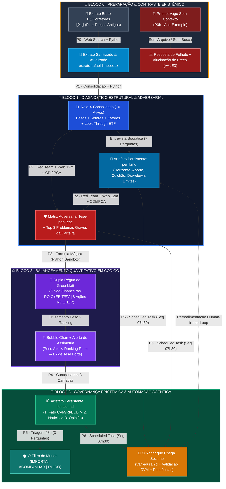

# 🏛️ Engenharia Reversa & Re-Engenharia Simbólica de Sistemas Cognitivos Financeiros (v1.0)
## 🎬 Deconstrução Arquitetural do Sistema *"Claude para Investidores"* (Leonardo Dawadji · Market Makers Academy)

> [!IMPORTANT]
> **Escopo da Engenharia Reversa (`ID: zNVHixsE1ik`)**
> Este documento executa a **engenharia reversa integral** e a **re-engenharia formal** do sistema interativo demonstrado por **Leonardo Dawadji** (COO da Across Capital, 18 anos de mercado financeiro) na Masterclass ***"Claude para Investidores: aprenda a usar IA para turbinar sua carteira de investimentos"*** (Market Makers Academy). O artefato abrange:
> 1. **Formalismo Simbólico Unicode ($\mathcal{F}_{\Sigma}$)** da arquitetura de engenharia de prompts, execução determinística de código, *look-through* de ativos e filtragem epistêmica.
> 2. **Mapeamento Estrutural de Todas as Abas ($\mathcal{T}_{0 \dots 8}$)** do *Playbook/Dashboard Web Interativo* exibido em tela.
> 3. **Transcrição Fiel de Todos os Prompts Originais ($\mathcal{P}_{0 \dots 6}$)** utilizados na apresentação (incluindo os prompts de preparação de dados e os anti-exemplos de contraste).
> 4. **Meta-Prompts de Re-Engenharia ($\mathcal{M}_{\text{sys}}$)** prontos para recriar o sistema completo (com todas as abas, gráficos, tabelas, *cards* colapsáveis e simulador de tarefas agendadas).

---

## 🧭 I. Fundamentos Teóricos & Formalismo Simbólico ($\mathcal{F}_{\Sigma}$)

* 🧠 **A. Axioma Central da Engenharia de Prompts Financeiros ($\Axiom_{\text{Dawadji}}$)**
  * 📐 **1. Lei da Conservação de Especificidade Epistêmica:**
    * 🔹 **a.** Um modelo de linguagem probabilístico $\mathcal{M}_{\theta}$ operando sem restrições de contexto ($\emptyset_{\text{ctx}}$), sem ancoragem de busca ($\neg \mathcal{W}_{\text{search}}$) e sem ambiente de execução determinística ($\neg \mathcal{E}_{\text{code}}$) degenera inevitavelmente para a **Média Estatística de Folheto ($\mu_{\text{brochure}}$)** e para a **Alucinação Estocástica de Cotações ($\epsilon_{\text{halluc}}$)**:
      $$\forall q \in \mathcal{Q}_{\text{vago}}, \quad \mathcal{M}_{\theta}\big(q \;\big|\; \emptyset_{\text{ctx}}, \neg \mathcal{W}_{\text{search}}, \neg \mathcal{E}_{\text{code}}\big) \;\Longrightarrow\; \mu_{\text{brochure}} \oplus \epsilon_{\text{halluc}}$$
    * 🔹 **b.** A transformação do LLM em um **Sistema Analítico Fiduciário ($\Omega_{\text{fiduciary}}$)** exige a composição formal de cinco operadores ortogonais sobre o estado da carteira $\mathbf{X}_{t}$:
      $$\Omega_{\text{fiduciary}}(\mathbf{X}_{t}) \;\triangleq\; \Big(\mathcal{A}_{\text{cron}} \circ \mathcal{F}_{\text{epist}} \circ \mathcal{Q}_{\text{quant}} \circ \mathcal{R}_{\text{redteam}} \circ \mathcal{D}_{\text{raiox}} \circ \mathcal{S}_{\text{clean}}\Big)(\mathbf{X}_{t})$$
  * 🔣 **2. Dicionário de Glifos Unicode & Operadores Formais do Sistema:**
    * 💠 **i.** $\llbracket \mathbf{X}_{0} \rrbracket \in \mathbb{R}^{N \times K}$ — Matriz bruta do extrato da B3/Corretoras com $N$ linhas fragmentadas e $K$ atributos contendo PII (CPF, Conta, Investidor) e preços defasados.
    * 💠 **ii.** $\mathcal{S}_{\text{clean}} : \llbracket \mathbf{X}_{0} \rrbracket \times \mathcal{W}_{\text{search}}(t_{\text{pregão}}) \mapsto \big(\mathbf{X}_{\text{full}}, \mathbf{X}_{\text{clean}}\big)$ — Operador de sanitização de dados, anonimização de PII e atualização de fechamento com recalibração inteira $\lfloor q_{i}' \rceil \in \mathbb{Z}^{+}$.
    * 💠 **iii.** $\mathcal{D}_{\text{raiox}} : \mathbf{X}_{\text{clean}} \mapsto \big(\mathbf{W}_{\text{cons}}, \mathbf{\Sigma}_{\text{setor}}, \mathbf{\Phi}_{\text{fator}}, \mathcal{L}_{\text{ETF}}\big) \vdash \neg \text{Rec}(\text{Buy/Sell})$ — Operador de consolidação multi-corretora, decomposição *look-through* de ETFs ($\mathcal{L}_{\text{ETF}}$) e entrevista socrática de perfil ($\Psi_{\text{perfil}}$) sob restrição estrita de não-recomendação prévia.
    * 💠 **iv.** $\mathcal{R}_{\text{redteam}} : \big(\mathbf{W}_{\text{cons}} \otimes \mathbf{\Theta}_{\text{teses}} \otimes \Psi_{\text{perfil}}\big) \times \mathcal{W}_{\text{search}}(\Delta t = 12\text{m}) \mapsto \nabla_{\text{cético}}$ — Operador adversarial (*Red Team*) que confronta cada tese subjetiva $\theta_{i} \in \mathbf{\Theta}_{\text{teses}}$ contra fatos relevantes (CVM/RI), custo de oportunidade ($\text{CDI}, \text{IPCA}+r_{\text{real}}$) e quebras de limites autoimpostos ($\mathcal{B}_{\text{viol}}$).
    * 💠 **v.** $\mathcal{Q}_{\text{quant}} : \mathbf{W}_{\text{ações}} \mapsto \mathcal{G}_{\text{Greenblatt}}\big(\text{Rank}(\text{ROIC}) \oplus \text{Rank}(\text{EBIT/EV})\big) \cup \mathcal{G}_{\text{Adapt}}\big(\text{Rank}(\text{ROE}) \oplus \text{Rank}(\text{E/P})\big)$ — Operador quantitativo determinístico executado em *sandbox* Python ($\mathcal{E}_{\text{py}}$) que projeta a matriz de divergência $\Delta(\text{Peso}_{i}, \text{Rank}_{i})$.
    * 💠 **vi.** $\mathcal{F}_{\text{epist}} : \mathcal{U}_{\text{info}} \mapsto \mathcal{H}_{1}(\text{Fato Primário}) \succ \mathcal{H}_{2}(\text{Notícia}) \succ \mathcal{H}_{3}(\text{Opinião/Ruído})$ — Hierarquia estrita de autoridade epistêmica materializada no artefato persistente `fontes.md`.
    * 💠 **vii.** $\mathcal{A}_{\text{cron}} : \texttt{cron}(\text{7d}) \times \big(\mathbf{X}_{\text{clean}}, \mathbf{\Theta}_{\text{teses}}, \texttt{perfil.md}, \texttt{fontes.md}\big) \stackrel{\circlearrowleft}{\longrightarrow} \mathcal{R}_{\text{radar}}$ — Agente autônomo agendado na nuvem (*Scheduled Task*) com validação documental na CVM/RI e retroalimentação *Human-in-the-Loop*.

---

## 🗺️ II. Arquitetura Global do Sistema & Fluxo de Estado (Mermaid Colorido)

* 🏗️ **A. Pipeline End-to-End de Engenharia Cognitiva da Carteira**
  * 📊 **1. Diagrama de Fluxo Arquitetural ($\mathcal{P}_{0} \longrightarrow \mathcal{P}_{6}$):**



---

## 🖥️ III. Engenharia Reversa da Interface: Mapeamento de Todas as Abas ($\mathcal{T}_{0 \dots 8}$)

* 🗂️ **A. Inventário Completo das Abas do Sistema Demonstrado**

| Código da Aba | Rótulo na Barra Superior | Breadcrumb Superior | Título Principal (H1) | Artefatos de Entrada ($\text{In}$) | Motores do Claude Ativados | Artefatos de Saída ($\text{Out}$) |
| :--- | :--- | :--- | :--- | :--- | :--- | :--- |
| **`T0`** | `Início` | `CLAUDE PARA INVESTIDORES` | **Roteiro da Masterclass & Visão do Sistema** | Carteira Bruta B3 | Visão Sistêmica (3 Blocos) | Mapa de 6 Prompts + Fluxo de Projeto |
| **`T1`** | `P0 · Extrato` | `P0 · PREPARAÇÃO DO DADO` | **Preparação do extrato** | `extrato-rafael.xlsx` (com PII e preços antigos) | `Web Search` + `Code Execution (Python/openpyxl)` | `extrato-rafael-completo.xlsx` + `extrato-rafael-limpo.xlsx` |
| **`T2`** | `P0 · Sem contexto` | `P0 · BLOCO 0 — ANTES DE COMEÇAR` | **Pergunta vaga, resposta de folheto** | Apenas lista de 10 *tickers* no texto | Chat Puro (Sem busca, sem arquivo, sem código) | Resposta genérica + Alucinação de preço (`VALE3` a R$ 70–75 vs R$ 61,40) |
| **`T3`** | `P1 · Raio-X` | `P1 · BLOCO 1 — DIAGNÓSTICO` | **Raio-X antes de qualquer opinião** | `extrato-rafael-limpo.xlsx` | `Python (pandas/matplotlib)` + `Socratic Interview` | Tabela consolidada (10 ativos, R$ 300k), 2 Gráficos, Top 3 Concentrações (`BOVA11` *look-through*) + `perfil.md` |
| **`T4`** | `P2 · Red Team` | `P2 · BLOCO 1 — DIAGNÓSTICO` | **Red Team: o analista cético** | `extrato-rafael-limpo.xlsx` + `perfil.md` + 10 Teses | `Web Search (12m CVM/RI)` + Comparação `CDI/IPCA+` | Tabela `Tese por tese` (5 colunas) + `Os 3 problemas mais graves, em ordem` |
| **`T5`** | `P3 · Fórmula` | `P3 · BLOCO 2 — BALANCEAMENTO` | **EBIT/EV: comparando em código (Fórmula Mágica)** | 8 Ações da carteira (`ITUB4`, `BBDC4`, `BPAC11`, `PETR4`, `VALE3`, `PRIO3`, `WEGE3`, `ABEV3`) | `Web Search (12m DRE/Balanço)` + `Python (Ranking + Bubble Chart)` | Gráfico de Bolhas (6 empresas) + Tabela Adaptada (8 ações) + Alerta `Peso alto, ranking ruim` |
| **`T6`** | `P4 · Fontes` | `P4 · BLOCO 3 — ACOMPANHAMENTO` | **Quem escolhe a fonte escolhe a notícia** | 8 Empresas + 4 Fatores Macro da Carteira | `Web Search (Validação de URLs e Códigos CVM)` | Arquivo `fontes.md` (3 Camadas: Fato ≻ Notícia ≻ Opinião + Matriz Fator × Fonte + 5 Regras) |
| **`T7`** | `P5 · Filtro do dia` | `P5 · BLOCO 3 — ACOMPANHAMENTO` | **O filtro do mundo** | `fontes.md` + Carteira + Fatores Macro | `Web Search (Últimas 48h)` + Triagem de 3 Perguntas | Placar (`X varridas — Y importam`) + Tabela de Impacto + Lista `RUÍDO — NÃO VALE A LEITURA` |
| **`T8`** | `P6 · Tarefa agendada` | `P6 · BLOCO 3 — AUTOMATIZANDO` | **O radar que chega sozinho** | Projeto Claude (`extrato`, `teses`, `perfil.md`, `fontes.md`) | `Scheduled Tasks (Cloud Cron)` + Checagem Oficial CVM/RI | Relatório Semanal (`31 notícias. 5 importam.`) + Links Oficiais + `Ordens do dono / pendências` |

---

## 📜 IV. Catálogo Integral dos Prompts Originais Utilizados no Vídeo ($\mathcal{P}_{0 \dots 6}$)

* 🧹 **A. Prompt `P0 — Preparação do extrato`:**
```text
Anexei um extrato fictício que vou usar numa aula.

1. Atualize a coluna Preço de Fechamento com o fechamento do último pregão de cada ativo. Busque e cite a fonte de cada preço.
2. Recalcule a Quantidade, em número inteiro, pra que o Valor Atualizado de cada linha fique o mais perto possível do valor que está hoje no arquivo.
3. Troque a data de referência pela data do último pregão.

Mantenha abas, colunas, cabeçalho e formatação. Me devolva dois arquivos .xlsx:
- extrato-rafael-completo.xlsx: igual ao original, atualizado.
- extrato-rafael-limpo.xlsx: o mesmo, sem as linhas de Investidor e CPF e sem a coluna Conta.
```

* ⚠️ **B. Prompts `P0b — Pergunta vaga, resposta de folheto` (1 de 2 e 2 de 2):**
```text
Tenho ITUB4, BBDC4, BPAC11, PETR4, VALE3, PRIO3, WEGE3, ABEV3, BOVA11 e IVVB11. Minha carteira está boa?
```
```text
Quanto está a VALE3 hoje? Responda sem buscar na internet.
```

* 🔬 **C. Prompt `P1 — Raio-X antes de qualquer opinião`:**
```text
Anexei o extrato de posição da minha carteira (Área do Investidor da B3). Antes de qualquer opinião, quero um raio-X.

1. Consolide: se o mesmo ativo aparece em mais de uma corretora, junte numa linha só.
2. Classifique cada ativo por tipo (ação, ETF, FII, BDR), setor e principal fator de risco (juros, commodities, consumo, dólar ou outro).
3. Calcule o peso de cada ativo, de cada setor e de cada fator. Faça as contas usando código, não de cabeça.
4. Mostre uma tabela e um gráfico de alocação por setor.
5. Aponte as 3 concentrações mais relevantes, inclusive as que estão escondidas em tickers diferentes.

Não recomende comprar nem vender nada.

Depois do raio-X, me entreviste pra entender meu perfil: no máximo 7 perguntas numeradas sobre objetivo, horizonte, aportes, reserva de emergência, quanto de queda eu aguento, que limites eu quero ter e como eu acompanho o mercado. Espere minhas respostas antes de continuar.
```

* 🛡️ **D. Prompt `P2 — Red Team`:**
```text
Anexei o extrato-rafael-limpo.xlsx e o meu perfil. Faça um Red Team na minha carteira.

Quero que você seja o analista mais cético que a minha carteira já viu: me mostre onde eu estou errado, não me agrade.

Regras:
- Use a busca na web pra ver o que aconteceu com cada empresa nos últimos 12 meses (resultado, fato relevante, mudança de diretoria ou de guidance). Cite a fonte e a data de cada dado. Não chute número de cabeça.
- Compare o CDI atual, o IPCA e o juro real com o que cada posição precisa entregar pra valer o risco.
- Procure sobreposição: ETF que carrega ações que eu já tenho separadas.
- Procure narrativas que funcionaram no passado e podem não valer mais no preço de hoje.
- Compare os pesos com os limites que eu mesmo defini no meu perfil.
- Não me diga pra comprar ou vender: me faça a pergunta difícil.

Minhas teses (uma linha por ativo: tese — por que comprei — quando):
ITUB4 — banco mais rentável, paga dividendo, é o porto seguro — 2021
BBDC4 — barato e vai recuperar — 2023
BPAC11 — cresce mais que os outros bancos — 2022
PETR4 — dividendo — 2022
VALE3 — a China vai voltar a crescer — 2023
PRIO3 — petróleo com crescimento — 2023
WEGE3 — empresa mais bem gerida da bolsa, sempre sobe — 2021
ABEV3 — todo mundo bebe cerveja, defensiva — 2020
BOVA11 — pra diversificar — 2022
IVVB11 — ter dólar e bolsa americana — 2023

Entregue uma tabela: Ativo | Minha tese | O que mudou (com fonte e data) | Risco que eu não estou vendo | Pergunta que eu preciso responder.
Depois, os 3 problemas mais graves da carteira como um todo, em ordem de gravidade.
```

* 🧮 **E. Prompt `P3 — Fórmula Mágica de Joel Greenblatt`:**
```text
Quero uma lente que não seja a minha opinião: a Fórmula Mágica do Joel Greenblatt, aplicada só às empresas da minha carteira.

1. Para cada empresa da carteira, busque o dado mais recente dos últimos 12 meses, com fonte e data de cada número:
   - Qualidade: retorno sobre o capital (ROIC, ou ROE para bancos).
   - Preço: EBIT sobre valor da firma (ou Lucro sobre valor de mercado, P/L invertido, onde EBIT/EV não se aplica — bancos).
   Explique primeiro por que a fórmula original do Greenblatt exclui bancos e como você vai adaptar pra comparar tudo na mesma régua (e o limite dessa adaptação).
2. Calcule o Ranking: rank 1 = melhor qualidade, rank 1 = mais barato, e some os dois ranks (menor soma = melhor posição). Faça as contas usando código, não de cabeça.
3. Deixe os ETFs (BOVA11 e IVVB11) de fora do ranking e explique em uma linha por quê.
4. Separe duas tabelas: (a) a Fórmula original nas empresas não-financeiras (ROIC + EBIT/EV) e (b) o ranking adaptado com as 8 ações (ROE + Lucro/Valor de Mercado).
5. Mostre uma tabela: Ativo | Peso na carteira | Qualidade + rank | Preço + rank | Soma dos ranks | Posição final | Fonte.
6. Faça um gráfico de bolhas, usando código: eixo horizontal = preço (EBIT/EV), eixo vertical = qualidade (ROIC), tamanho da bolha = peso na carteira.
7. Cruza ranking com peso: aponte onde eu tenho peso alto e ranking ruim. Isso não é ordem de venda: é onde a minha tese precisa ser mais forte.

Regras: trabalhe só com os ativos da minha carteira, busque e cite fontes, não recomende ativos de fora.
```

* 🏛️ **F. Prompt `P4 — Quem escolhe a fonte escolhe a notícia`:**
```text
Quero o meu arquivo de fontes pra acompanhar esta carteira. Três camadas, nesta ordem de autoridade:

1. FATO (primário): canal oficial de fatos relevantes na CVM/B3, o site de Relações com Investidores (RI) de cada uma das 8 empresas da carteira, e as fontes oficiais dos fatores macro da minha carteira: Banco Central (juros/Focus/câmbio), IBGE (IPCA/atividade), ANP/OPEP (petróleo) e Fed/BLS (juros EUA). Busque e confira cada endereço.
2. NOTÍCIA (jornalismo financeiro): Valor Econômico, Brazil Journal, InfoMoney, NeoFeed e Reuters/Bloomberg Línea (sem muro de pagamento quando houver alternativa; indique quais têm paywall).
3. OPINIÃO (casa de análise, podcast, YouTube, Twitter/X, grupo de WhatsApp): não coloque na lista — escreva a regra de como tratar quando eu trouxer uma opinião.

Depois, me mostre:
- Uma tabela por camada: Fonte | O que cobre | URL verificada | Periodicidade | Paywall.
- Uma matriz Fator da carteira × Fonte primária que cobre aquele fator.
- 5 regras de ouro pra nunca confundir opinião com fato.

Me entregue esse arquivo fontes.md, pronto pra salvar no meu projeto do Claude.
```

* 🌪️ **G. Prompt `P5 — O filtro do mundo`:**
```text
Use as fontes do arquivo fontes.md deste projeto, na ordem de autoridade. Busque as notícias das últimas 48 horas sobre as empresas da carteira e sobre os fatores macro (juros, câmbio, petróleo, minério, inflação).

Passe cada notícia por três perguntas:
1. Isso é fato primário, notícia ou opinião/ruído?
2. Mexe na tese de algum ativo da minha carteira, ou é só variação de preço do dia?
3. Exige alguma ação ou checagem minha, ou é só acompanhar?

Separe em três listas:
- IMPORTA: muda ou testa a tese de um ativo. Explique em 2 linhas por quê e cite a fonte.
- ACOMPANHAR: relevante pro setor ou fator, mas não muda nada hoje. Uma linha por item.
- RUÍDO: manchete que parece urgente mas não muda fundamento. Liste só o título e em meia linha por que não importa.

Comece o relatório com o placar: "X notícias varridas — Y importam — Z acompanhar — W ruído".
```

* 🤖 **H. Prompt `P6 — O radar que chega sozinho`:**
```text
Você é o radar semanal da carteira descrita neste projeto (extrato, teses, perfil.md e fontes.md).

1. Use as fontes de fontes.md, na ordem de autoridade, e busque os eventos dos últimos 7 dias sobre as empresas da carteira e sobre os fatores macro (juros, câmbio, petróleo, minério, inflação).
2. Passe cada item pelas três perguntas do filtro (é fato primário? mexe na tese? exige ação?).
3. Pra cada item que IMPORTA, verifique se teve fato relevante na CVM ou comunicado no RI da empresa. Se não teve documento oficial, rebaixe pra ACOMPANHAR ou avise que ainda não é fato primário.
4. Cruze os eventos com as teses e com os limites do perfil.md: aponte se alguma tese ficou mais fraca ou se algum limite foi violado.
5. Entregue em uma página, começando pelo placar ("X notícias, Y importam"):
   - Os itens que IMPORTAM (com fonte, data e qual tese/limite afetam).
   - Os itens pra ACOMPANHAR (uma linha cada).
   - Contagem do que foi descartado como RUÍDO.
   - Lista de links dos documentos oficiais pra eu abrir só o que precisa de leitura humana.

Zero recomendação de compra ou venda. Só triagem, checagem de tese e priorização do meu tempo.
```
