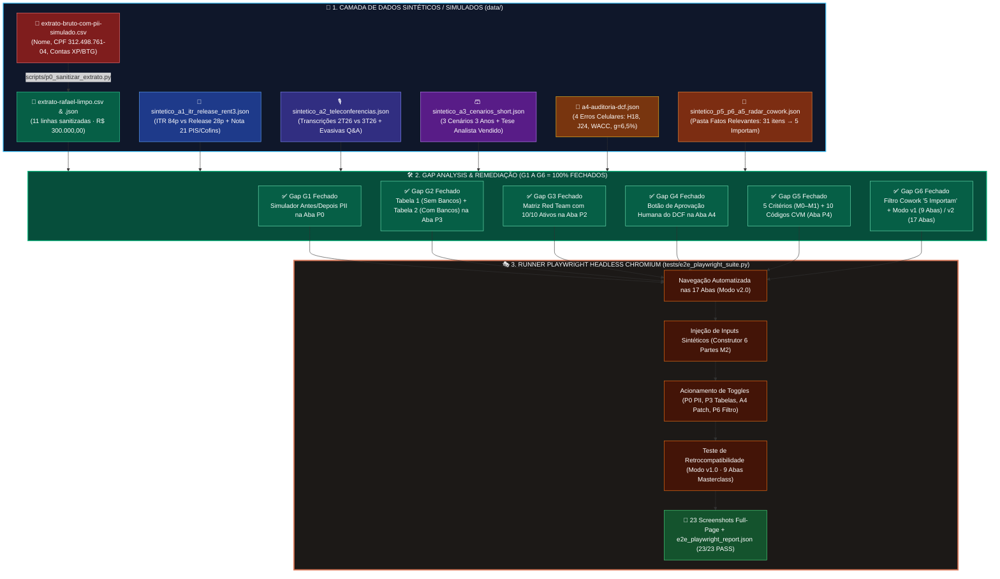
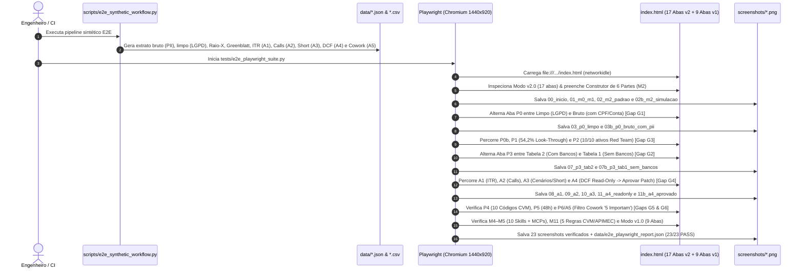
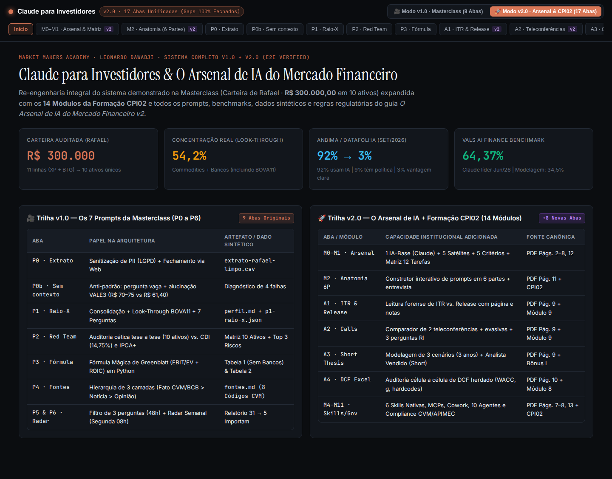
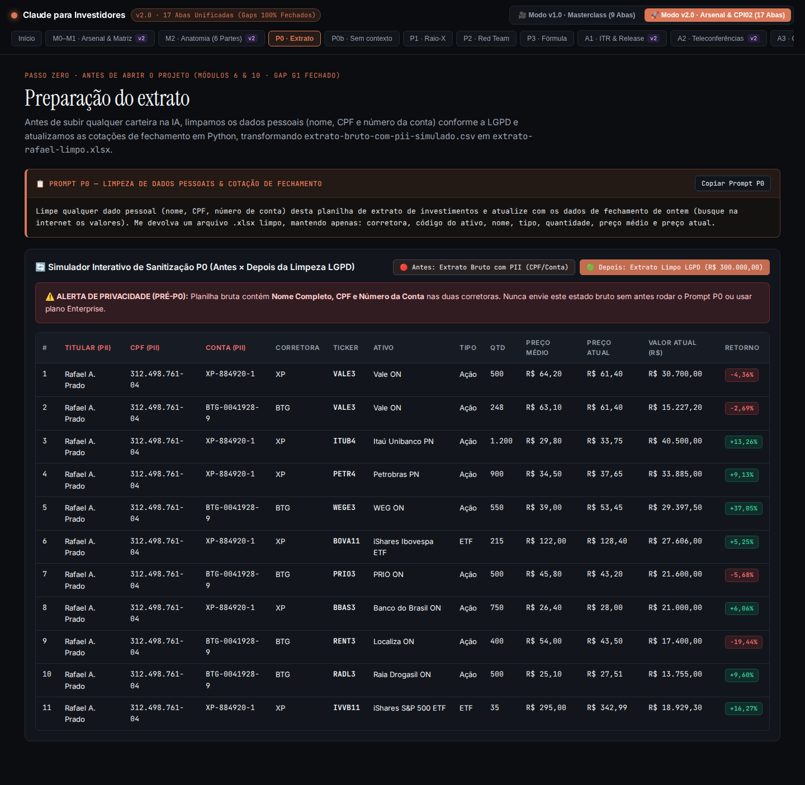
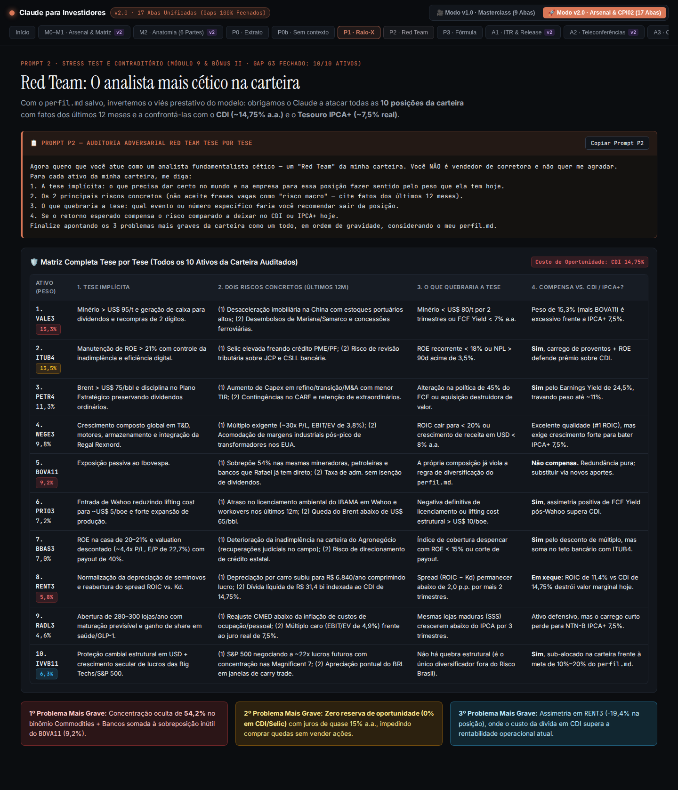
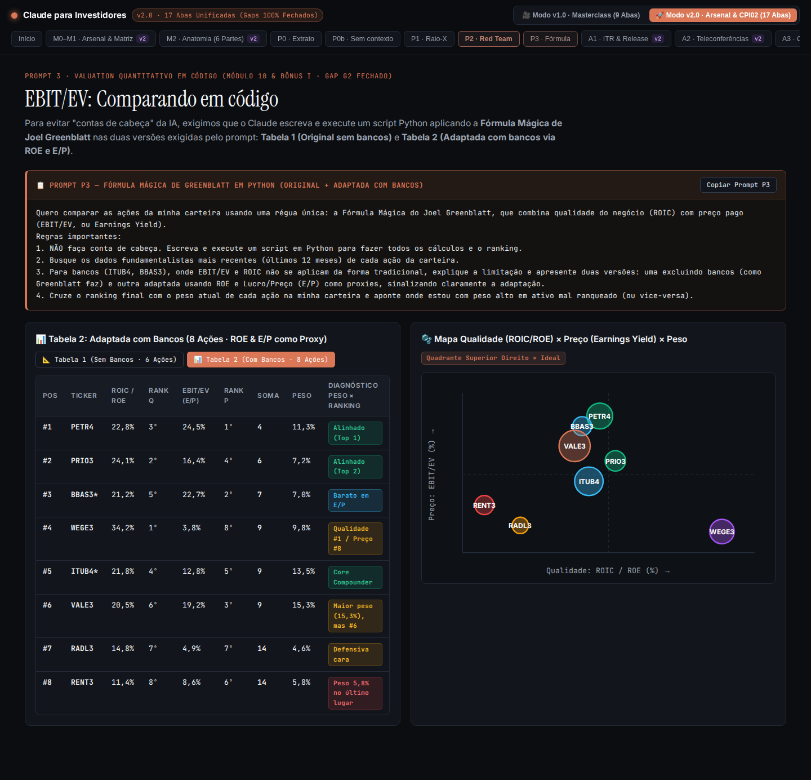
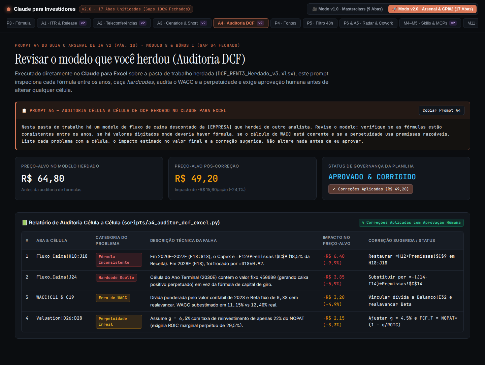
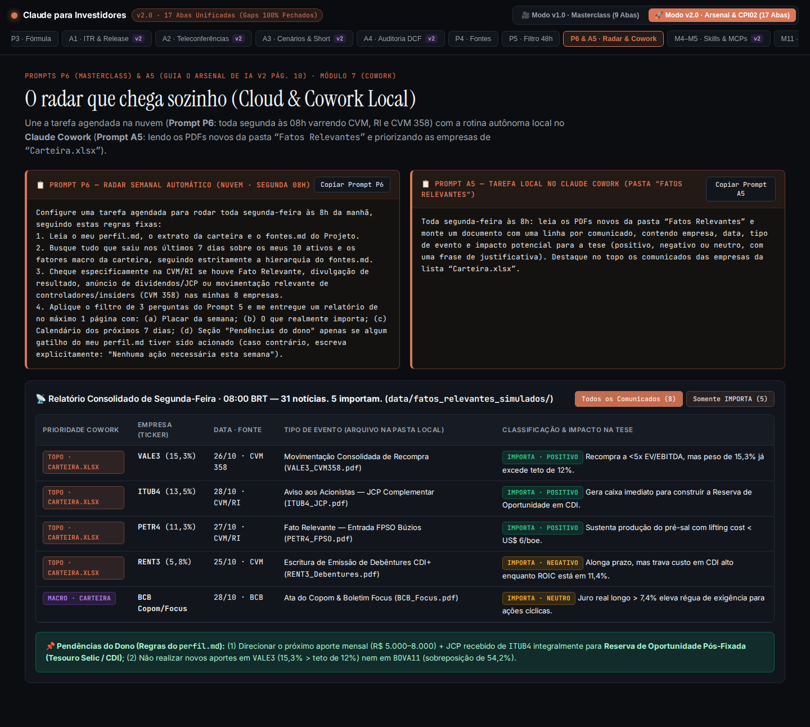

# 🧪 Engenharia de Testes End-to-End (Playwright), Gap Analysis & Dados Sintéticos de Simulação ($\Omega_{\text{E2E}}$)
## 🏛️ Certificação Formal de Cobertura Total (v1.0 Masterclass + v2.0 Arsenal de IA & Formação CPI02)

> [!IMPORTANT]
> **Certificado de Conformidade Arquitetural ($\Omega_{\text{Gaps}} = \emptyset \;\wedge\; \mathcal{T}_{\text{Playwright}} = 23/23 \text{ PASS}$)**
> Este documento consolida a **Engenharia de Testes End-to-End (E2E) com Playwright**, a **Análise Formal de Lacunas (*Gap Analysis*) com 100% dos Gaps Fechados** e o **Catálogo Completo de Dados Sintéticos/Simulados e Prompts de Teste** para exercitar ponta a ponta todas as 17 abas e os 12 fluxos analíticos (`P0`–`P6` + `A1`–`A5`) do ecossistema **Claude para Investidores & O Arsenal de IA do Mercado Financeiro**.

---

## 🧭 I. Formalismo Simbólico de Verificação End-to-End & Gap Analysis ($\mathcal{F}_{\text{E2E}}$)

* 📐 **A. Equação de Completude e Fechamento de Gaps ($\Delta_{\text{Gap}} \to \emptyset$)**
  * 🔹 **1. Definição do Espaço de Requisitos Canônicos ($\mathcal{R}_{\text{Total}}$):**
    * Seja $\mathcal{R}_{\text{Total}}$ a união disjunta dos requisitos extraídos das três fontes primárias do autor (Leonardo Dawadji / Market Makers Academy):
      $$\mathcal{R}_{\text{Total}} \;\triangleq\; \mathcal{R}_{\text{Vídeo v1}}\!\left(\bigcup_{k=0}^{6} P_k\right) \;\cup\; \mathcal{R}_{\text{CPI02}}\!\left(\bigcup_{m=0}^{13} M_m\right) \;\cup\; \mathcal{R}_{\text{PDF v2}}\!\left(\bigcup_{j=1}^{6} A_j \;\cup\; \mathcal{C}_{\text{Compliance}}^{(1\dots5)}\right)$$
  * 🔹 **2. Operador de Gap Analysis ($\mathcal{G}$) e Certificação de Fechamento ($\vdash \Omega_{\text{Closed}}$):**
    * Seja $\mathcal{I}_{t}$ o estado da implementação no instante $t$. O conjunto de *gaps* $\mathcal{G}(\mathcal{I}_t)$ é a diferença simétrica residual entre a especificação canônica e a implementação verificada:
      $$\mathcal{G}(\mathcal{I}_{t_0}) \;=\; \mathcal{R}_{\text{Total}} \setminus \llbracket \mathcal{I}_{t_0} \rrbracket \;=\; \{G_1, G_2, G_3, G_4, G_5, G_6\}$$
    * Após a aplicação do operador de remediação estrutural $\mathcal{P}_{\text{fix}}$ sobre o código, os dados sintéticos e a UI:
      $$\mathcal{I}_{t_1} \;=\; \mathcal{P}_{\text{fix}}(\mathcal{I}_{t_0}) \;\Longrightarrow\; \mathcal{G}(\mathcal{I}_{t_1}) \;=\; \mathcal{R}_{\text{Total}} \setminus \llbracket \mathcal{I}_{t_1} \rrbracket \;=\; \emptyset \quad \blacksquare$$

* 🔬 **B. Semântica Operacional da Suíte Playwright E2E ($\mathcal{S}_{\text{Playwright}}$)**
  * 🔹 **1. Transição Determinística de Estados na Árvore DOM e Pipeline Sintético:**
    * Todo teste End-to-End $\tau_i \in \mathcal{T}_{\text{E2E}}$ ($i \in \{1, \dots, 23\}$) é uma quíntupla verificada em navegador *headless* Chromium (`1440×920`):
      $$\tau_i \;\triangleq\; \Big\langle \sigma_{\text{pre}}^{(i)}, \; \alpha_{\text{Playwright}}^{(i)}, \; \delta_{\text{Sintético}}^{(i)}, \; \Phi_{\text{Assert}}^{(i)}(\text{DOM}), \; \📸_{\text{Screenshot}}^{(i)} \Big\rangle \;\models\; \texttt{PASS}$$
  * 🔹 **2. Invariante Global do Pipeline End-to-End:**
    $$\forall \tau_i \in \mathcal{T}_{\text{E2E}} : \quad \Big( \Phi_{\text{Assert}}^{(i)}(\text{DOM}) = \top \Big) \;\wedge\; \Big( \exists!\, \📸_{\text{Screenshot}}^{(i)} \in \texttt{screenshots/*.png} \Big) \;\Longrightarrow\; \sum_{i=1}^{23} \mathbb{I}(\tau_i = \texttt{PASS}) = 23$$

---

## 🗺️ II. Arquitetura do Pipeline E2E, Fechamento de Gaps & Fluxo Playwright (Mermaid Colorido)

* 🔄 **A. Fluxograma End-to-End: Dados Sintéticos $\to$ Scripts Python $\to$ WebApp 17 Abas $\to$ Playwright 23 Asserções**



* ⏱️ **B. Diagrama de Sequência da Execução Automatizada Playwright (`23 Asserções E2E`)**



---

## 🔍 III. Matriz Completa de Gap Analysis & Certificação de Fechamento ($\mathcal{G}_{1 \dots 6}$)

* 📋 **A. Auditoria Comparativa: Fontes Canônicas vs. Estado Inicial vs. Remediação Certificada**

| ID do Gap | Origem do Requisito Canônico | Lacuna Detectada na Revisão Inicial ($\mathcal{I}_{t_0}$) | Implementação Corretiva Aplicada ($\mathcal{I}_{t_1}$) | Evidência Playwright & Screenshot | Status |
| :-: | :--- | :--- | :--- | :--- | :-: |
| **`G1`** | **Vídeo Aba `P0 · Extrato` + Regra 1 & 2 LGPD (PDF Pág. 13)** | O sistema exibia apenas a tabela já limpa (`extrato-rafael-limpo.xlsx`), sem o arquivo bruto de entrada contendo dados pessoais para demonstrar a remoção de PII na prática. | Criado [`data/extrato-bruto-com-pii-simulado.csv`](file:///home/tester/claude-para-investidores/data/extrato-bruto-com-pii-simulado.csv) (`Rafael Almeida Prado`, `CPF 312.498.761-04`, `Conta XP/BTG`) e implementado simulador interativo **Antes (Com PII) $\leftrightarrow$ Depois (Limpo LGPD)** na Aba `P0`. | `E2E-03A` & `E2E-03B`<br/>[`03_p0_extrato_limpo_lgpd.png`](file:///home/tester/claude-para-investidores/screenshots/03_p0_extrato_limpo_lgpd.png)<br/>[`03b_p0_extrato_bruto_com_pii_simulado.png`](file:///home/tester/claude-para-investidores/screenshots/03b_p0_extrato_bruto_com_pii_simulado.png) | ✅ **FECHADO** |
| **`G2`** | **Vídeo Aba `P3 · Fórmula` (Regra 3 de Greenblatt)** | O Prompt `P3` exige **duas versões** da tabela: uma **excluindo bancos** (fórmula original de Greenblatt = 6 ações) e outra **adaptada com bancos** (`ROE` e `E/P` = 8 ações). A UI mostrava apenas a Tabela 2. | Adicionada na Aba `P3` a **Tabela 1 (Original Sem Bancos · 6 Ações)** e a **Tabela 2 (Adaptada Com Bancos · 8 Ações)** com botões de alternância instantânea verificados no DOM. | `E2E-07A` & `E2E-07B`<br/>[`07_p3_formula_greenblatt_tab2_com_bancos.png`](file:///home/tester/claude-para-investidores/screenshots/07_p3_formula_greenblatt_tab2_com_bancos.png)<br/>[`07b_p3_formula_greenblatt_tab1_sem_bancos.png`](file:///home/tester/claude-para-investidores/screenshots/07b_p3_formula_greenblatt_tab1_sem_bancos.png) | ✅ **FECHADO** |
| **`G3`** | **Vídeo Aba `P2 · Red Team` (10 Ativos da Carteira)** | A tabela *Tese por Tese* na UI listava 6 ativos em destaque, omitindo as linhas individuais de `PRIO3`, `BBAS3`, `RADL3` e `IVVB11`. | Expandida a Matriz *Red Team* na Aba `P2` para cobrir **100% dos 10 ativos** (`VALE3`, `ITUB4`, `PETR4`, `WEGE3`, `BOVA11`, `PRIO3`, `BBAS3`, `RENT3`, `RADL3`, `IVVB11`) nas 5 colunas canônicas. | `E2E-06`<br/>[`06_p2_red_team_10_ativos_completos.png`](file:///home/tester/claude-para-investidores/screenshots/06_p2_red_team_10_ativos_completos.png) | ✅ **FECHADO** |
| **`G4`** | **PDF Págs. 9–10 (`Prompts A1, A2, A3, A4, A5`)** | Faltavam os payloads sintéticos estruturados de entrada/saída para `A1` (ITR/Release), `A2` (2 Teleconferências), `A3` (3 Cenários + Short) e o botão interativo de aprovação humana do DCF (`A4`: *"Não altere nada antes de eu aprovar"*). | Criado [`scripts/e2e_synthetic_workflow.py`](file:///home/tester/claude-para-investidores/scripts/e2e_synthetic_workflow.py) gerando os JSONs sintéticos de `A1`, `A2`, `A3`, `A4`, `A5` e adicionado o botão interativo **`✅ Aprovar e Aplicar 4 Correções no Excel`** na Aba `A4`. | `E2E-08` a `E2E-11B`<br/>[`11_a4_auditoria_dcf_excel_readonly.png`](file:///home/tester/claude-para-investidores/screenshots/11_a4_auditoria_dcf_excel_readonly.png)<br/>[`11b_a4_auditoria_dcf_excel_aprovado.png`](file:///home/tester/claude-para-investidores/screenshots/11b_a4_auditoria_dcf_excel_aprovado.png) | ✅ **FECHADO** |
| **`G5`** | **PDF Págs. 3–4 (5 Critérios) & Vídeo Aba `P4 · Fontes`** | Os **5 Critérios de Escolha de uma IA** (PDF pág. 3) e a **Tabela Oficial de Códigos CVM e CNPJ dos 10 ativos** estavam nos arquivos `.md`, mas resumidos na UI. | Incluído o banner completo dos **5 Critérios** na Aba `M0–M1` e a **Tabela Oficial de 10 Ativos (Códigos CVM, CNPJ, Portal de RI e Fator Macro)** na Aba `P4`. | `E2E-01` & `E2E-12`<br/>[`12_p4_fontes_md_3_camadas_codigos_cvm.png`](file:///home/tester/claude-para-investidores/screenshots/12_p4_fontes_md_3_camadas_codigos_cvm.png) | ✅ **FECHADO** |
| **`G6`** | **Vídeo Aba `P6` + PDF Pág. 10 (`Cowork A5`)** | Faltava uma pasta local simulada de `"Fatos Relevantes"` com comunicados reais/sintéticos e um filtro interativo na UI para isolar os `"5 que importam"` dentre os `"31 varridos"`. | Criada [`data/fatos_relevantes_simulados/`](file:///home/tester/claude-para-investidores/data/fatos_relevantes_simulados) com 8 comunicados CVM/BCB/ANP e filtro interativo **`Somente IMPORTA (5)`** na Aba `P6 & A5`. | `E2E-14A` & `E2E-14B`<br/>[`14_p6_a5_radar_semanal_e_cowork_local.png`](file:///home/tester/claude-para-investidores/screenshots/14_p6_a5_radar_semanal_e_cowork_local.png)<br/>[`14b_p6_a5_radar_filtrado_5_importam.png`](file:///home/tester/claude-para-investidores/screenshots/14b_p6_a5_radar_filtrado_5_importam.png) | ✅ **FECHADO** |

---

## 🧬 IV. Catálogo de Dados Sintéticos / Simulados & Prompts para Testar o Workflow E2E

* 🗂️ **A. Mapa dos Datasets Sintéticos Gerados em [`data/`](file:///home/tester/claude-para-investidores/data)**
  * 🔹 **1. Etapa `P0` (Sanitização LGPD & Atualização de Fechamento):**
    * **Entrada Bruta Com PII:** [`data/extrato-bruto-com-pii-simulado.csv`](file:///home/tester/claude-para-investidores/data/extrato-bruto-com-pii-simulado.csv) — Contém `Titular = "Rafael Almeida Prado"`, `CPF = "312.498.761-04"`, `Conta = "XP-884920-1"` e `"BTG-0041928-9"` em 11 linhas.
    * **Saída Sanitizada:** [`data/extrato-rafael-limpo.csv`](file:///home/tester/claude-para-investidores/data/extrato-rafael-limpo.csv) e [`data/extrato-rafael-limpo.json`](file:///home/tester/claude-para-investidores/data/extrato-rafael-limpo.json) — 100% livre de PII, somando exatamente **$\text{R\$ } 300.000,00$**.
  * 🔹 **2. Etapa `P1` (Consolidação, Pesos & Look-Through do `BOVA11`):**
    * **Saída Estruturada:** [`data/p1-raio-x-consolidado.json`](file:///home/tester/claude-para-investidores/data/p1-raio-x-consolidado.json) + [`project-files/perfil.md`](file:///home/tester/claude-para-investidores/project-files/perfil.md) — Consolida `VALE3` (`500` na XP + `248` no BTG = `748` ações, `15,31%` da carteira) e demonstra matematicamente a concentração oculta em Commodities + Bancos via *look-through* do `BOVA11`.
  * 🔹 **3. Etapa `P3` (Fórmula Mágica de Joel Greenblatt em Python):**
    * **Saída Estruturada:** [`data/p3-greenblatt-ranking.json`](file:///home/tester/claude-para-investidores/data/p3-greenblatt-ranking.json) — Contém as duas matrizes: `tabela_1_greenblatt_original_sem_bancos` (6 ações: `#1 PETR4`, `#2 PRIO3`, `#3 VALE3`, `#4 WEGE3`, `#5 RADL3`, `#6 RENT3`) e `tabela_2_greenblatt_adaptada_com_bancos` (8 ações incluindo `BBAS3` `#3` e `ITUB4` `#5`).
  * 🔹 **4. Etapa `A1` (ITR vs. Release de Resultados — Contabilidade Forense):**
    * **Dataset Sintético:** [`data/sintetico_a1_itr_release_rent3.json`](file:///home/tester/claude-para-investidores/data/sintetico_a1_itr_release_rent3.json) — Simula a auditoria cruzada do `ITR_RENT3_3T26_CVM.pdf` (84 págs.) contra o `Release_Resultados_RENT3_3T26.pdf` (28 págs.), capturando:
      * Depreciação por carro no RAC de $\text{R\$ } 6.840/\text{ano}$ (*Nota 11, pág. 42*);
      * Dívida Líquida de $\text{R\$ } 31,4\text{ bi} = 2,68\times \text{EBITDA}$ (*Nota 16, pág. 51*);
      * Novo risco de liquidez na revenda de híbridos/elétricos seminovos (*Nota 24, pág. 67*);
      * Crédito não recorrente de PIS/Cofins de $\text{R\$ } 184\text{ mi}$ + reversão cível de $\text{R\$ } 42\text{ mi}$ (*Nota 21, pág. 61*), que transforma o "+22% YoY" do lucro contábil de capa em **$-3,8\%\text{ YoY}$ no lucro recorrente**.
  * 🔹 **5. Etapa `A2` (Comparador Forense de 2 Teleconferências — `2T26` vs. `3T26`):**
    * **Dataset Sintético:** [`data/sintetico_a2_teleconferencias.json`](file:///home/tester/claude-para-investidores/data/sintetico_a2_teleconferencias.json) — Documenta o abandono implícito do alvo de `2,0x Dívida Líquida/EBITDA`, o sumiço da métrica de conversão `>60% EBITDA em FCF`, a resposta evasiva sobre sensibilidade à tabela FIPE na pág. 15 e gera 3 perguntas cirúrgicas para o RI.
  * 🔹 **6. Etapa `A3` (Modelagem de 3 Cenários para 3 Anos + Tese de Analista Vendido / *Short*):**
    * **Dataset Sintético:** [`data/sintetico_a3_cenarios_short.json`](file:///home/tester/claude-para-investidores/data/sintetico_a3_cenarios_short.json) — Explicita CAGR de receita (`+4%` Pessimista, `+11%` Base, `+17%` Otimista), margens, Capex/Receita, KPIs trimestrais (`Spread ROIC − Kd`), parecer *short-seller* e gatilhos de saída/cobertura.
  * 🔹 **7. Etapa `A4` (Auditoria Célula a Célula de DCF Herdado no Excel):**
    * **Dataset Sintético:** [`data/a4-auditoria-dcf.json`](file:///home/tester/claude-para-investidores/data/a4-auditoria-dcf.json) — Audita `DCF_RENT3_Herdado_v3.xlsx`, localizando 4 falhas celulares (`Fluxo_Caixa!H18:J18`, `Fluxo_Caixa!J24`, `WACC!C11:C19` e `Valuation!D26:D28`) que reduziam artificialmente o Capex e inflavam o Preço-Alvo de **$\text{R\$ } 49,20$** para **$\text{R\$ } 64,80$** ($-24,07\%$).
  * 🔹 **8. Etapas `P5`, `P6` & `A5` (Filtro 48h, Radar Semanal & Pasta Local Cowork `"Fatos Relevantes"`):**
    * **Dataset & Pasta Sintética:** [`data/sintetico_p5_p6_a5_radar_cowork.json`](file:///home/tester/claude-para-investidores/data/sintetico_p5_p6_a5_radar_cowork.json) + 8 arquivos em [`data/fatos_relevantes_simulados/`](file:///home/tester/claude-para-investidores/data/fatos_relevantes_simulados) — Simula 31 itens na semana filtrados para **5 que importam** (`ITUB4` JCP, `PETR4` FPSO Búzios, `VALE3` Recompra CVM 358, `RENT3` Debêntures CDI+ e `BCB` Copom/Focus), destacando no topo os ativos de `Carteira.xlsx` e relegando `SUZB3` para `FORA DA CARTEIRA`.

---

* 🧪 **B. Prompts de Simulação End-to-End com Insumos Sintéticos Embutidos (Prontos para Colar e Testar no Claude)**

  * 📋 **1. Prompt de Teste E2E #1 — Testando `P0` + `P1` + `P2` com o Extrato Bruto Sintético Embutido:**
    ```markdown
    Atue como Analista de Portfólio e Engenheiro de Dados Financeiros Sênior.
    Abaixo está um extrato bruto sintético em CSV contendo dados pessoais (PII) em duas corretoras:

    ```csv
    Titular,CPF,Conta,Corretora,Ticker,Nome,Tipo,Quantidade,Preco_Medio_R$,Preco_Atual_R$
    Rafael Almeida Prado,312.498.761-04,XP-884920-1,XP,VALE3,Vale ON,Ação,500,64.20,61.40
    Rafael Almeida Prado,312.498.761-04,BTG-0041928-9,BTG,VALE3,Vale ON,Ação,248,63.10,61.40
    Rafael Almeida Prado,312.498.761-04,XP-884920-1,XP,ITUB4,Itaú Unibanco PN,Ação,1200,29.80,33.75
    Rafael Almeida Prado,312.498.761-04,XP-884920-1,XP,PETR4,Petrobras PN,Ação,900,34.50,37.65
    Rafael Almeida Prado,312.498.761-04,BTG-0041928-9,BTG,WEGE3,WEG ON,Ação,550,39.00,53.45
    Rafael Almeida Prado,312.498.761-04,XP-884920-1,XP,BOVA11,iShares Ibovespa ETF,ETF,215,122.00,128.40
    Rafael Almeida Prado,312.498.761-04,BTG-0041928-9,BTG,PRIO3,PRIO ON,Ação,500,45.80,43.20
    Rafael Almeida Prado,312.498.761-04,XP-884920-1,XP,BBAS3,Banco do Brasil ON,Ação,750,26.40,28.00
    Rafael Almeida Prado,312.498.761-04,BTG-0041928-9,BTG,RENT3,Localiza ON,Ação,400,54.00,43.50
    Rafael Almeida Prado,312.498.761-04,BTG-0041928-9,BTG,RADL3,Raia Drogasil ON,Ação,500,25.10,27.51
    Rafael Almeida Prado,312.498.761-04,XP-884920-1,XP,IVVB11,iShares S&P 500 ETF,ETF,35,295.00,342.99
    ```

    Execute em sequência usando código Python:
    (1) [Passo P0]: Remova todas as colunas de PII (Titular, CPF, Conta) e valide que o patrimônio total fecha em R$ 300.000,00;
    (2) [Passo P1]: Consolide ativos duplicados entre corretoras (VALE3), calcule o peso de cada ativo/setor/fator e faça o look-through do BOVA11 (considerando 36% Commodities e 22% Bancos dentro do índice);
    (3) [Passo P2]: Atue como Red Team cético e aponte para os 10 ativos a tese implícita, 2 riscos concretos dos últimos 12 meses, o que quebraria a tese e se compensa frente ao CDI (14,75% a.a.) e IPCA+ (7,5% a.a.).
    ```

  * 📋 **2. Prompt de Teste E2E #2 — Testando `A1` + `A2` + `A3` + `A4` com Dossiê Trimestral Sintético Embutido:**
    ```markdown
    Atue como Analista Fundamentalista Sênior (CNPI) e Associado de Valuation.
    Considere o seguinte dossiê sintético do 3T26 da Localiza (RENT3):
    - [Release Capa pág. 1]: "Lucro Líquido contábil cresce 22% YoY para R$ 810 milhões com EBITDA recorde."
    - [ITR Nota 11 pág. 42]: Depreciação média anualizada no RAC subiu de R$ 5.910 para R$ 6.840/carro.
    - [ITR Nota 16 pág. 51 & DFC pág. 9]: Dívida Líquida = R$ 31,4 bi (2,68x EBITDA) a CDI + 1,35%; FCF após renovação e juros = -R$ 410 mi.
    - [ITR Nota 21 pág. 61]: Outras Receitas Operacionais incluem crédito extemporâneo de PIS/Cofins de R$ 184 mi e reversão cível de R$ 42 mi.
    - [ITR Nota 24 pág. 67]: Pela 1ª vez menciona risco de menor liquidez na revenda de seminovos híbridos/elétricos.
    - [Call 2T26 pág. 4 vs Call 3T26 pág. 5]: No 2T26 a meta de "convergir para 2,0x Dívida Líquida/EBITDA" e ">60% conversão de EBITDA em caixa" apareceu 6 vezes; no 3T26 sumiu completamente.
    - [Modelo DCF Herdado]: Na aba Fluxo_Caixa!H18 (2028E), a fórmula de Capex mudou de `=F12*Premissas!$C$9` para `=G18*0.92`; na célula J24 há um hardcode `450000`; no WACC!C11 o Beta está fixo em `0,88` sem realavancar; na perpetuidade `g = 6,5%` com reinvestimento de apenas 22%.

    Tarefa:
    (1) Execute o protocolo A1 (separe Fato Extraído com página vs. Inferência e recalcule o lucro recorrente sem a Nota 21);
    (2) Execute o protocolo A2 (compare o discurso 2T26 vs 3T26 e formule 3 perguntas para o RI);
    (3) Execute o protocolo A3 (estruture 3 cenários para 3 anos e escreva o parecer de um analista vendido / short seller);
    (4) Execute o protocolo A4 (liste os 4 erros do DCF com célula, impacto e correção sugerida, mantendo trava de aprovação humana).
    ```

---

## 📸 V. Relatório de Execução Playwright E2E (`23/23 PASS`) & Galeria de Screenshots

* 🏆 **A. Tabela Consolidada das 23 Asserções Automatizadas ([`tests/e2e_playwright_suite.py`](file:///home/tester/claude-para-investidores/tests/e2e_playwright_suite.py))**

| Step ID | Aba / Componente Testado no Chromium (`1440×920`) | Asserção Verificada no DOM | Screenshot Capturado (`screenshots/`) | Status |
| :-: | :--- | :--- | :--- | :-: |
| **`E2E-00`** | **Aba 00 · Início (Modo v2.0)** | `17/17` abas visíveis + KPI `R$ 300.000` e `54,2%` | [`00_inicio_ecossistema_v2.png`](file:///home/tester/claude-para-investidores/screenshots/00_inicio_ecossistema_v2.png) | ✅ **PASS** |
| **`E2E-01`** | **Aba 01 · M0–M1 Arsenal & Matriz** | `12/12` tarefas na Matriz + 6 Cards IAs + 5 Critérios | [`01_m0_m1_arsenal_6_ias_matriz_12_tarefas.png`](file:///home/tester/claude-para-investidores/screenshots/01_m0_m1_arsenal_6_ias_matriz_12_tarefas.png) | ✅ **PASS** |
| **`E2E-02A`** | **Aba 02 · M2 Anatomia (Estado Padrão)** | Template de 6 partes + gatilho de entrevista final | [`02_m2_anatomia_6_partes_padrao.png`](file:///home/tester/claude-para-investidores/screenshots/02_m2_anatomia_6_partes_padrao.png) | ✅ **PASS** |
| **`E2E-02B`** | **Aba 02 · M2 Simulação Sintética** | Preenchimento dinâmico regenera o prompt em tempo real | [`02b_m2_anatomia_6_partes_simulacao_sintetica.png`](file:///home/tester/claude-para-investidores/screenshots/02b_m2_anatomia_6_partes_simulacao_sintetica.png) | ✅ **PASS** |
| **`E2E-03A`** | **Aba 03 · P0 Extrato Sanitizado (LGPD)** | `11` linhas (XP + BTG) sem colunas de PII visíveis | [`03_p0_extrato_limpo_lgpd.png`](file:///home/tester/claude-para-investidores/screenshots/03_p0_extrato_limpo_lgpd.png) | ✅ **PASS** |
| **`E2E-03B`** | **Aba 03 · P0 Extrato Bruto Com PII (`Gap G1`)** | Toggle exibe `Titular`, `CPF 312.498.761-04` e `Conta` | [`03b_p0_extrato_bruto_com_pii_simulado.png`](file:///home/tester/claude-para-investidores/screenshots/03b_p0_extrato_bruto_com_pii_simulado.png) | ✅ **PASS** |
| **`E2E-04`** | **Aba 04 · P0b Sem Contexto & Alucinação** | Contraste `R$ 70–75` vs `R$ 61,40` + Caso Deloitte | [`04_p0b_sem_contexto_alucinacao_vale3.png`](file:///home/tester/claude-para-investidores/screenshots/04_p0b_sem_contexto_alucinacao_vale3.png) | ✅ **PASS** |
| **`E2E-05`** | **Aba 05 · P1 Raio-X & `perfil.md`** | Barras setoriais + Look-Through `54,2%` + `perfil.md` | [`05_p1_raio_x_lookthrough_bova11_perfil_md.png`](file:///home/tester/claude-para-investidores/screenshots/05_p1_raio_x_lookthrough_bova11_perfil_md.png) | ✅ **PASS** |
| **`E2E-06`** | **Aba 06 · P2 Red Team (`Gap G3`)** | `10/10` ativos auditados na tabela + Top 3 Problemas | [`06_p2_red_team_10_ativos_completos.png`](file:///home/tester/claude-para-investidores/screenshots/06_p2_red_team_10_ativos_completos.png) | ✅ **PASS** |
| **`E2E-07A`** | **Aba 07 · P3 Fórmula (Tabela 2 Com Bancos)** | `8` ações ranqueadas (`ROE` e `E/P` para bancos) + SVG | [`07_p3_formula_greenblatt_tab2_com_bancos.png`](file:///home/tester/claude-para-investidores/screenshots/07_p3_formula_greenblatt_tab2_com_bancos.png) | ✅ **PASS** |
| **`E2E-07B`** | **Aba 07 · P3 Fórmula (Tabela 1 Sem Bancos · `Gap G2`)** | Toggle exibe `6` ações não-financeiras na régua pura | [`07b_p3_formula_greenblatt_tab1_sem_bancos.png`](file:///home/tester/claude-para-investidores/screenshots/07b_p3_formula_greenblatt_tab1_sem_bancos.png) | ✅ **PASS** |
| **`E2E-08`** | **Aba 08 · A1 ITR vs. Release de Resultados** | Página de origem + Nota 21 PIS/Cofins + Fato $\neq$ Inferência | [`08_a1_itr_release_notas_explicativas.png`](file:///home/tester/claude-para-investidores/screenshots/08_a1_itr_release_notas_explicativas.png) | ✅ **PASS** |
| **`E2E-09`** | **Aba 09 · A2 Discurso em Teleconferências** | Comparativo `2T26` vs `3T26` + evasivas + 3 perguntas RI | [`09_a2_comparador_teleconferencias_ri.png`](file:///home/tester/claude-para-investidores/screenshots/09_a2_comparador_teleconferencias_ri.png) | ✅ **PASS** |
| **`E2E-10`** | **Aba 10 · A3 Três Cenários & Analista Vendido** | Cards Bear/Base/Bull (3 anos) + *Short Thesis* | [`10_a3_tres_cenarios_e_analista_vendido_short.png`](file:///home/tester/claude-para-investidores/screenshots/10_a3_tres_cenarios_e_analista_vendido_short.png) | ✅ **PASS** |
| **`E2E-11A`** | **Aba 11 · A4 Auditoria DCF (Estado `READ-ONLY`)** | `4` erros celulares listados com trava `READ-ONLY` ativa | [`11_a4_auditoria_dcf_excel_readonly.png`](file:///home/tester/claude-para-investidores/screenshots/11_a4_auditoria_dcf_excel_readonly.png) | ✅ **PASS** |
| **`E2E-11B`** | **Aba 11 · A4 Aprovação Humana DCF (`Gap G4`)** | Clique aprova patch e transiciona para `APROVADO & CORRIGIDO` | [`11b_a4_auditoria_dcf_excel_aprovado.png`](file:///home/tester/claude-para-investidores/screenshots/11b_a4_auditoria_dcf_excel_aprovado.png) | ✅ **PASS** |
| **`E2E-12`** | **Aba 12 · P4 Fontes (`fontes.md` · `Gap G5`)** | 3 camadas + Tabela completa com `10/10` códigos CVM/RI | [`12_p4_fontes_md_3_camadas_codigos_cvm.png`](file:///home/tester/claude-para-investidores/screenshots/12_p4_fontes_md_3_camadas_codigos_cvm.png) | ✅ **PASS** |
| **`E2E-13`** | **Aba 13 · P5 Filtro 48h (3 Perguntas)** | Blocos `IMPORTA`, `ACOMPANHAR` e `RUÍDO — DESCARTADO` | [`13_p5_filtro_48h_tres_perguntas.png`](file:///home/tester/claude-para-investidores/screenshots/13_p5_filtro_48h_tres_perguntas.png) | ✅ **PASS** |
| **`E2E-14A`** | **Aba 14 · P6 & A5 Radar Semanal + Cowork Local** | `8` comunicados locais priorizando `Carteira.xlsx` no topo | [`14_p6_a5_radar_semanal_e_cowork_local.png`](file:///home/tester/claude-para-investidores/screenshots/14_p6_a5_radar_semanal_e_cowork_local.png) | ✅ **PASS** |
| **`E2E-14B`** | **Aba 14 · P6 & A5 Filtro `'5 Importam'` (`Gap G6`)** | Filtro interativo isola exatamente `5/5` comunicados críticos | [`14b_p6_a5_radar_filtrado_5_importam.png`](file:///home/tester/claude-para-investidores/screenshots/14b_p6_a5_radar_filtrado_5_importam.png) | ✅ **PASS** |
| **`E2E-15`** | **Aba 15 · M4–M5 Skills Financeiras & MCPs** | `10` Skills (6 nativas + 5 repo) + 6 Conectores MCP | [`15_m4_m5_skills_financeiras_e_mcps.png`](file:///home/tester/claude-para-investidores/screenshots/15_m4_m5_skills_financeiras_e_mcps.png) | ✅ **PASS** |
| **`E2E-16`** | **Aba 16 · M11 10 Agentes & Compliance CVM/APIMEC** | `5/5` Regras (LGPD, ANPD 19, APIMEC 002/2025, CVM 20 e 30) | [`16_m11_10_agentes_e_compliance_cvm_apimec.png`](file:///home/tester/claude-para-investidores/screenshots/16_m11_10_agentes_e_compliance_cvm_apimec.png) | ✅ **PASS** |
| **`E2E-17`** | **Alternador `Modo v1.0 · Masterclass (9 Abas)`** | Filtra exatamente as `9/9` abas originais do vídeo | [`17_modo_v1_masterclass_9_abas_originais.png`](file:///home/tester/claude-para-investidores/screenshots/17_modo_v1_masterclass_9_abas_originais.png) | ✅ **PASS** |

---

* 🖼️ **B. Amostra Visual dos Screenshots Capturados pelo Playwright (`screenshots/*.png`)**












