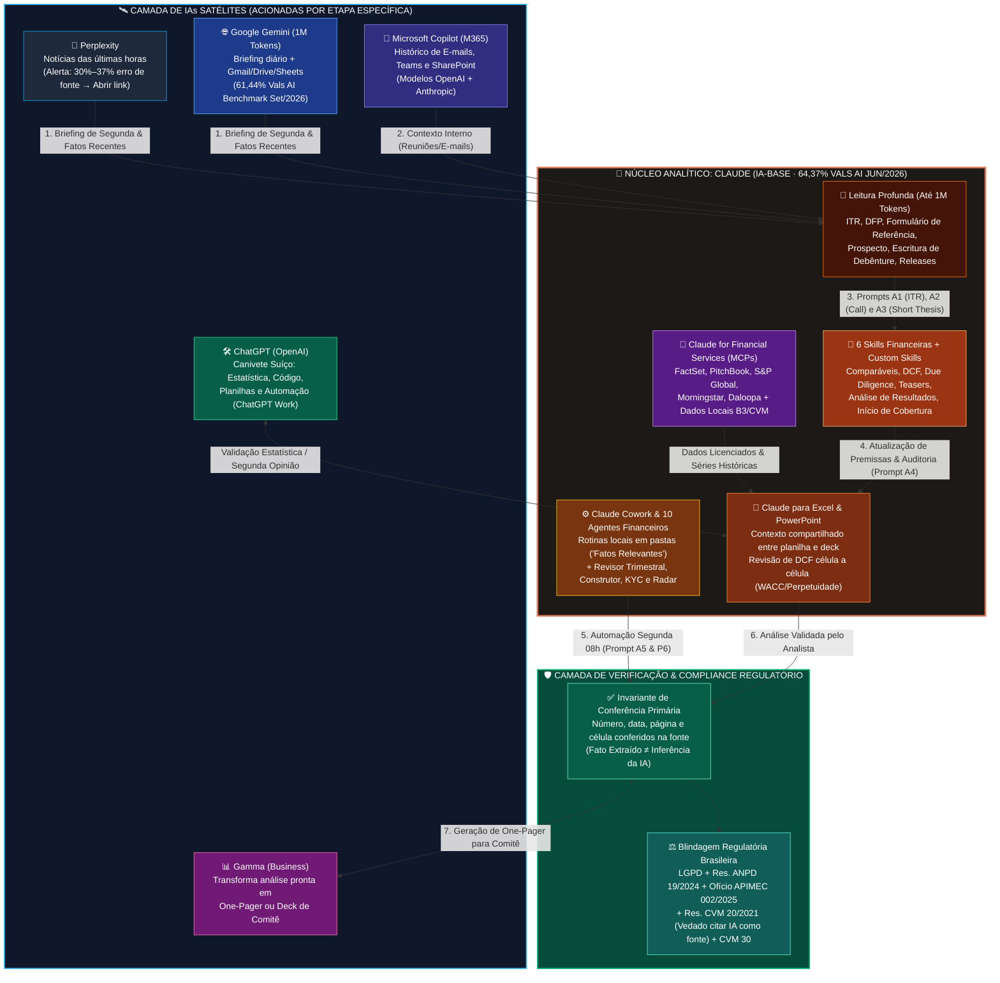
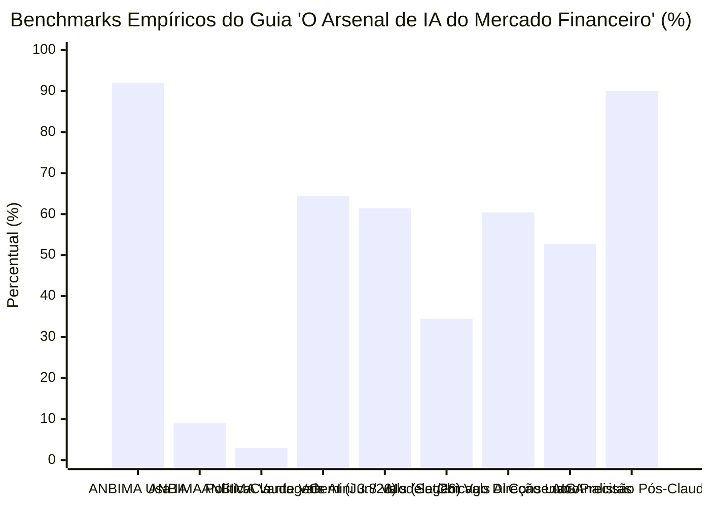

# 🚀 Upgrade Arquitetural v2.0: Sistema Cognitivo Institucional *"Claude para Investidores & O Arsenal de IA do Mercado Financeiro"*
## 🏛️ Engenharia Reversa & Re-Engenharia Simbólica Unificada (Masterclass + Formação Completa CPI02 + Guia *O Arsenal de IA v2*)

> [!IMPORTANT]
> **Escopo do Upgrade v2.0 ($\Omega_{\text{v1}} \stackrel{\mathcal{U}}{\longrightarrow} \Omega_{\text{v2}}$)**
> Este documento expande a engenharia reversa da Masterclass ([`ENGENHARIA_REVERSA_V1_MASTERCLASS.md`](file:///home/tester/claude-para-investidores/ENGENHARIA_REVERSA_V1_MASTERCLASS.md)) em uma **Arquitetura Institucional v2.0**, integrando **100% dos componentes, módulos, métricas, prompts, *Skills*, *Connectors/MCPs*, *Cowork* e diretrizes regulatórias** provenientes das duas fontes canônicas adicionais de **Leonardo Dawadji** e do **Market Makers Academy**:
> 1. **Formação Completa CPI02 (`https://store.mmakers.com.br/claude-investidores-cpi02-b`):** Os **14 Módulos** (`Módulos 0 a 11` + `Bônus I: Valuation com IA` + `Bônus II: Gestão de Portfólio`) e os **9 Entregáveis Estruturais** (*Skills* proprietárias, *Artifacts*, *Connectors e MCPs*, *Projects*, *Cowork*, *Claude nas Ferramentas*, *Engenharia Reversa com IA*, *Claude Code para Finanças*, *Agentes Financeiros*, *Planilha Elaboradora de Prompts* e *Guias de Segurança e Confidencialidade*).
> 2. **Guia Técnico ([`O-Arsenal-de-IA-do-Mercado-Financeiro-v2.pdf`](file:///home/tester/Downloads/O-Arsenal-de-IA-do-Mercado-Financeiro-v2.pdf)):** A topologia **1 IA-Base + 5 IAs Satélites** (`Claude`, `ChatGPT`, `Gemini`, `Microsoft Copilot`, `Perplexity`, `Gamma`), a teoria da **Fronteira Irregular (*Jagged Frontier*)**, os **5 Critérios de Seleção**, os **Benchmarks Empíricos (ANBIMA, McKinsey, Vals AI, FinanceBench, Chicago, Vectara, Stanford)**, os **5 Prompts Analíticos Avançados ($\mathcal{A}_{1 \dots 5}$)**, a **Anatomia Hexagonal do Prompt ($\mathcal{H}_{6}$)**, a **Matriz de Decisão de 12 Tarefas** e o **Protocolo Regulatório (LGPD, ANPD nº 19/2024, APIMEC nº 002/2025, CVM nº 20/2021 e CVM nº 30)**.

---

## 🧭 I. Formalismo Simbólico do Upgrade v2.0 ($\mathcal{F}_{\Sigma}^{\text{v2}}$)

* 🧠 **A. Teorema da Fronteira Irregular & Assimetria Competitiva na Faria Lima ($\Theorem_{\text{Jagged}}$)**
  * 📐 **1. Paradoxo da Adoção vs. Vantagem Real (ANBIMA/Datafolha Set/2026 & McKinsey Ago/2026):**
    * 🔹 **a.** Seja $\mathcal{I}_{\text{mkt}}$ o conjunto das $177$ instituições do mercado de capitais brasileiro pesquisadas pela ANBIMA/Datafolha:
      $$\mathbb{P}(\text{Usa IA} \mid \mathcal{I}_{\text{mkt}}) = 0.92 \;\wedge\; \mathbb{P}(\text{Usa GenAI} \mid \mathcal{I}_{\text{mkt}}) = 0.67 \;\Longrightarrow\; \mathbb{P}(\text{Política Formal}) = 0.09 \;\wedge\; \mathbb{P}(\text{Vantagem Clara}) = 0.03$$
    * 🔹 **b.** No recorte global da McKinsey ($\text{Ago/2026}$), $\mathbb{P}(\text{Usa IA}) = 0.89$, mas apenas $\mathbb{P}(\text{High Performers}) = 0.06$ geram impacto material no resultado.
  * 🔣 **2. Equação da Fronteira Tecnológica Irregular (*Dell'Acqua et al., Harvard/MIT/Wharton/BCG, 2023*):**
    * 🔹 **a.** Seja $\mathcal{F}_{\text{cap}} \subset \mathcal{T}$ o subconjunto de tarefas situadas **dentro** da fronteira de capacidade do modelo e $\overline{\mathcal{F}_{\text{cap}}} = \mathcal{T} \setminus \mathcal{F}_{\text{cap}}$ o subconjunto situado **fora** da fronteira. O vetor de ganho de desempenho $\vec{\Delta}(\tau)$ para um analista $\alpha$ em uma tarefa $\tau \in \mathcal{T}$ obedece à bifurcação descontínua:
      $$\vec{\Delta}(\tau) \;\triangleq\; \begin{cases} \langle +12.2\% \text{ volume},\; +25.1\% \text{ velocidade},\; +40.0\% \text{ qualidade} \rangle & \text{se } \tau \in \mathcal{F}_{\text{cap}} \text{ (Dentro da Fronteira)} \\[6pt] \langle -19.0\text{ p.p. probabilidade de acerto vs. trabalho humano solo} \rangle & \text{se } \tau \in \overline{\mathcal{F}_{\text{cap}}} \text{ (Fora da Fronteira)} \end{cases}$$
    * 🔹 **b.** **Corolário Operacional do Guia:** Extrair vantagem competitiva ($\in 3\%$ da ANBIMA / $6\%$ da McKinsey) requer três decisões formais:
      $$\Omega_{\text{vantagem}} \;\equiv\; \Big\langle \underbrace{\mathcal{B}_{\text{Claude}}}_{\text{1. IA-Base Analítica}}, \; \underbrace{\{\mathcal{S}_{k}\}_{k=1}^{5}}_{\text{2. Satélites por Etapa}}, \; \underbrace{\mathcal{V}_{\text{primária}}}_{\text{3. Protocolo de Verificação Primária}} \Big\rangle$$

* 🏛️ **B. Gramática Simbólica da Anatomia Hexagonal de um Bom Prompt ($\mathcal{G}_{\text{Hex}}$)**
  * 📐 **1. Todo prompt financeiro de nível institucional no sistema v2.0 é uma 6-tupla ordenada seguida por um operador de entrevista socrática pré-execução ($\mathcal{I}_{\text{ask}}$):**
    $$\mathcal{P}_{\text{inst}} \;\triangleq\; \Big( \rho_{\text{Papel}} \;\otimes\; \kappa_{\text{Contexto}} \;\otimes\; \mu_{\text{Material}} \;\otimes\; \tau_{\text{Tarefa}}^{(1 \dots n)} \;\otimes\; \phi_{\text{Formato}} \;\otimes\; \nu_{\text{Verificação}} \Big) \;\triangleright\; \mathcal{I}_{\text{ask}}$$
    * 💠 **i.** $\rho_{\text{Papel}} \in \text{Personas}$ — Quem a IA deve ser (ex.: *"Atue como analista de crédito sênior"* ou *"analista vendido no papel"*).
    * 💠 **ii.** $\kappa_{\text{Contexto}} = \langle \text{Entregável}, \text{Público}, \text{Decisão} \rangle$ — Para quem é e qual decisão destrava (ex.: *"Para o comitê de amanhã, que decide se aumentamos a posição"*).
    * 💠 **iii.** $\mu_{\text{Material}} \subseteq \mathcal{D}_{\text{anexos}} \cup \texttt{fontes.md}$ — Restrição estrita de clausura documental (*"Use apenas os documentos anexados / fontes autorizadas"*).
    * 💠 **iv.** $\tau_{\text{Tarefa}}^{(1 \dots n)} = \langle \tau_1, \tau_2, \dots, \tau_n \rangle$ — Decomposição sequencial numerada das etapas cognitivas.
    * 💠 **v.** $\phi_{\text{Formato}} \in \{\text{Tabela}, \text{Uma Página}, \text{Planilha .xlsx}, \text{Artifact HTML}, \text{Deck}\}$ — Especificação da estrutura de saída.
    * 💠 **vi.** $\nu_{\text{Verificação}} = \text{Cite}(\text{Fonte}, \text{Página}, \text{Célula}) \;\wedge\; (\text{Fato} \cap \text{Inferência} = \emptyset) \;\wedge\; \neg \text{Estimar}(\text{Ausente})$ — Invariante de auditabilidade humana.
    * 💠 **vii.** $\mathcal{I}_{\text{ask}} \equiv \text{"Antes de começar, me faça as perguntas que precisar para fazer um bom trabalho."}$ — Gatilho que converte resposta genérica em resposta sob medida.

* 🔬 **C. Equação Completa do Ecossistema v2.0 (14 Módulos CPI02 $\times$ 6 IAs do Arsenal):**
  $$\Omega_{\text{v2}} \;\triangleq\; \mathcal{B}_{\text{Claude}}\!\left(\bigcup_{m=0}^{13} \text{Módulo}_{m}\right) \;\bowtie\; \bigoplus_{s \in \{\text{GPT}, \text{Gem}, \text{Cop}, \text{Pplx}, \text{Gam}\}} \mathcal{S}_{s} \;\bowtie\; \mathcal{C}_{\text{Compliance}}(\text{LGPD}, \text{ANPD}_{19}, \text{APIMEC}_{002}, \text{CVM}_{20,30})$$

---

## 🗺️ II. Arquitetura Multi-IA & Ecossistema CPI02 (Diagramas Mermaid Coloridos)

* 🛰️ **A. Topologia "Uma IA-Base, Cinco Satélites" & Fluxo da Semana de Resultados**



* 🎓 **B. Mapa Arquitetural dos 14 Módulos da Formação CPI02 (`store.mmakers.com.br/claude-investidores-cpi02-b`)**

```mermaid
flowchart LR
    subgraph B_FUND["🧱 TRILHA 1 · FUNDAÇÃO & PROMPTING"]
        M0["Módulo 0<br/>Fundamentos de IA<br/>(Fronteira Irregular & Tokens)"]
        M1["Módulo 1<br/>Como Funciona<br/>(5 Critérios & Benchmarks)"]
        M2["Módulo 2<br/>Dominando o Chat<br/>(Anatomia de 6 Partes)"]
    end

    subgraph B_PLAT["⚙️ TRILHA 2 · PLATAFORMA CLAUDE AVANÇADA"]
        M3["Módulo 3<br/>Artifacts<br/>(Dashboards & Visuais)"]
        M4["Módulo 4<br/>Connectors e MCPs<br/>(FactSet, CapIQ, B3/CVM)"]
        M5["Módulo 5<br/>Skills<br/>(6 Nativas + Custom SKILL.md)"]
        M6["Módulo 6<br/>Projects<br/>(perfil.md & fontes.md)"]
    end

    subgraph B_AUTO["🤖 TRILHA 3 · AUTOMAÇÃO, CÓDIGO & AGENTES"]
        M7["Módulo 7<br/>Cowork<br/>(Pastas Locais & Cron)"]
        M8["Módulo 8<br/>Claude nas Ferramentas<br/>(Excel, PowerPoint & Satélites)"]
        M9["Módulo 9<br/>Engenharia Reversa com IA<br/>(ITR, Teleconferências, Teses)"]
        M10["Módulo 10<br/>Claude Code para Finanças<br/>(Python, Greenblatt, Quant)"]
        M11["Módulo 11<br/>Agentes Financeiros<br/>(10 Agentes: Resultados, KYC...)"]
    end

    subgraph B_BONUS["🏆 TRILHA 4 · MÓDULOS BÔNUS APLICADOS"]
        MB1["Módulo Bônus I<br/>Valuation com IA<br/>(DCF, WACC, Perpetuidade)"]
        MB2["Módulo Bônus II<br/>Gestão de Portfólio<br/>(Sistema Completo P0–P6)"]
    end

    M0 --> M1 --> M2 --> M3 --> M4 --> M5 --> M6
    M6 --> M7 --> M8 --> M9 --> M10 --> M11
    M11 --> MB1 --> MB2

    style B_FUND fill:#1e293b,stroke:#60a5fa,stroke-width:2px,color:#ffffff
    style B_PLAT fill:#31102f,stroke:#f472b6,stroke-width:2px,color:#ffffff
    style B_AUTO fill:#1e1b4b,stroke:#a78bfa,stroke-width:2px,color:#ffffff
    style B_BONUS fill:#422006,stroke:#f59e0b,stroke-width:2px,color:#ffffff

    style M0 fill:#0f172a,stroke:#38bdf8,color:#ffffff
    style M1 fill:#0f172a,stroke:#38bdf8,color:#ffffff
    style M2 fill:#0f172a,stroke:#38bdf8,color:#ffffff
    style M3 fill:#500724,stroke:#f472b6,color:#ffffff
    style M4 fill:#500724,stroke:#f472b6,color:#ffffff
    style M5 fill:#500724,stroke:#f472b6,color:#ffffff
    style M6 fill:#500724,stroke:#f472b6,color:#ffffff
    style M7 fill:#2e1065,stroke:#c084fc,color:#ffffff
    style M8 fill:#2e1065,stroke:#c084fc,color:#ffffff
    style M9 fill:#2e1065,stroke:#c084fc,color:#ffffff
    style M10 fill:#2e1065,stroke:#c084fc,color:#ffffff
    style M11 fill:#2e1065,stroke:#c084fc,color:#ffffff
    style MB1 fill:#78350f,stroke:#fbbf24,color:#ffffff
    style MB2 fill:#78350f,stroke:#fbbf24,color:#ffffff
```



---

## 📊 III. Deconstrução Empírica & Matriz de Decisão do Guia *"O Arsenal de IA v2"*

* 📈 **A. Benchmarks Quantitativos & Evidências Empíricas Extraídas do PDF**
  * 🧪 **1. O Que os Testes Independentes Mostram ($\text{Set/Out 2026}$):**
    * 🔹 **a. Finance Agent Benchmark (*Vals AI, v1.1 Jun/2026 e v2 29/09/2026*):**
      * 💠 **i.** Em junho de 2026, o **Claude liderou** com **$64,37\%$** de acerto em perguntas reais de analista financeiro.
      * 💠 **ii.** Na versão v2 de $29/09/2026$ (ainda sem incluir os modelos mais recentes do Claude), o **Gemini 3.8 Flash** assumiu a ponta com **$61,44\%$** ($\sim 61\%$), enquanto o melhor resultado global em **modelagem financeira** atingiu apenas **$34,5\%$** — provando que quase 4 em cada 10 tarefas complexas de analista ainda exigem revisão humana rigorosa.
    * 🔹 **b. FinanceBench (*Islam et al., 2023*):**
      * 💠 **i.** Mediu **$81\%$ de erro ou recusa** do GPT-4 Turbo com busca ao responder perguntas sobre demonstrações financeiras sem a engenharia de contexto correta.
    * 🔹 **c. Análise de Balanços Anonimizados (*Kim, Muhn & Nikolaev, Univ. of Chicago, 2024*):**
      * 💠 **i.** Recebendo balanços padronizados e anonimizados, o modelo acertou a direção do lucro do ano seguinte em **$60,35\%$** dos casos, superando os **$52,71\%$** do consenso dos analistas humanos.
    * 🔹 **d. Taxas de Alucinação & Casos Reais de Falha de Verificação:**
      * 💠 **i. Vectara Hallucination Leaderboard (*Maio/2026*):** Taxa de alucinação varia de **$1,8\%$** nos melhores modelos a **mais de $24\%$** nos piores apenas para resumir um documento fornecido no próprio prompt.
      * 💠 **ii. Stanford (*Magesh et al., 2025*):** Ferramentas jurídicas pagas, vendidas como "livres de alucinação", inventaram respostas ou citações em **$17\%$ a $33\%$** das consultas.
      * 💠 **iii. Caso Deloitte (*Austrália, 2025*):** Aceitou devolver parte dos **$\text{A\$ } 440\text{ mil}$** recebidos do governo australiano após entregar relatório contendo citação fabricada por IA.
      * 💠 **iv. Auditoria de Buscadores de Notícias (*Tow Center/Columbia Mar/2025 & EBU/BBC Out/2025*):** O Perplexity apresentou **$37\%$ de erro** ao identificar a fonte de notícias (Columbia) e algum problema significativo em **$30\%$ das respostas** no estudo da EBU/BBC (ainda assim o melhor entre 4 assistentes, cuja média de erro foi **$45\%$**).
    * 🔹 **e. ROI Institucional Comprovado (*Casos Oficiais Anthropic 2025–2026*):**
      * 💠 **i. NBIM (Fundo Soberano da Noruega):** Economia média de **$\sim 20\%$ do tempo semanal** por funcionário nas tarefas assistidas pelo Claude.
      * 💠 **ii. Barclays:** Mais de **$16.000$ funcionários** utilizando assistente corporativo baseado no Claude.
      * 💠 **iii. AIG (Seguradora):** Revisão de apólices e riscos **mais de $5\times$ mais rápida**, com a precisão de extração de dados subindo de **$75\%$ para $>90\%$**.

* 📉 **B. Gráfico Comparativo de Benchmarks do Guia (Mermaid `xychart-beta`)**



* 🧭 **C. Linha do Tempo da Evolução do Claude para Finanças (`Jul/2025 – Set/2026`)**

| Período | Lançamento / Marco Tecnológico | Impacto no Fluxo de Trabalho do Investidor e Analista |
| :--- | :--- | :--- |
| **`Jul/2025`** | **Claude for Financial Services** | Conectores nativos (MCPs) para **FactSet, PitchBook, S&P Global, Morningstar, Daloopa** e outros provedores institucionais. |
| **`Out/2025`** | **Claude para Excel + 6 Skills Financeiras** | Operação direta dentro da planilha Excel e lançamento das **6 Skills nativas**: (1) Comparáveis, (2) DCF, (3) *Due Diligence*, (4) *Teasers*, (5) Análise de Resultados e (6) Relatórios de Início de Cobertura. |
| **`Fev–Abr/2026`** | **Claude para PowerPoint + Cowork Desktop** | Contexto compartilhado entre **Excel e PowerPoint**; liberação do **Cowork** para Mac e Windows (execução autônoma em pastas locais e tarefas agendadas). |
| **`Mai/2026`** | **10 Modelos de Agentes para Finanças** | Agentes especializados pré-configurados, incluindo **Revisor de Resultados Trimestrais**, **Construtor de Modelos Financeiros** e **Checagem de KYC**. |
| **`Set/2026`** | **Cowork Incorporado ao Chat** | Unificação da execução de rotinas multi-etapa em arquivos e tarefas agendadas diretamente na interface conversacional do Claude. |

* ⚖️ **D. Matriz de Decisão das 6 Ferramentas & 12 Tarefas de Mercado**

| # | Tarefa Analítica / Operacional | 🥇 Primeira Escolha (IA-Base / Satélite) | 🥈 Alternativa (Plano B / 2ª Opinião) | ⚠️ Regra Crítica de Verificação (Atenção) |
| :-: | :--- | :--- | :--- | :--- |
| **1** | **Ler ITR, DFP, release ou formulário de referência** | **Claude** (Janela até 1M tokens sem perder o fio) | Gemini | Confira cada número na página de origem citada. |
| **2** | **Comparar trimestres e teleconferências** | **Claude** | ChatGPT | Peça os trechos exatos citados entre aspas. |
| **3** | **Construir tese e cenários (3 anos)** | **Claude** | ChatGPT | Peça sempre a melhor argumentação contra (*short thesis*). |
| **4** | **Montar e revisar modelos no Excel (DCF)** | **Claude para Excel** | Copilot (*Agent Mode*), ChatGPT | Revise fórmulas célula a célula; proíba alterar sem aprovação. |
| **5** | **Cartas, e-mails e textos para clientes** | **Claude** | ChatGPT | Sem promessa de retorno (Res. CVM nº 20 e nº 30). |
| **6** | **Tarefas recorrentes automatizadas** | **Claude (Cowork)** | ChatGPT Work, Gemini Spark | Revise rigorosamente as primeiras execuções agendadas. |
| **7** | **Planilhas no Google Sheets** | **Gemini** | ChatGPT | Exija fórmulas dinâmicas, nunca valores fixos (*hardcoded*). |
| **8** | **Estatística e gráficos a partir de bases** | **ChatGPT** | Claude, Copilot | Peça sempre o código Python utilizado para auditar o cálculo. |
| **9** | **Notícias das últimas horas** | **Perplexity** | Gemini | Abra o link da fonte original (30%–37% de erro de atribuição). |
| **10** | **Briefing diário de mercado** | **Gemini** | Perplexity | Exija a fonte primária para cada item do briefing. |
| **11** | **Preparar reunião com histórico de e-mails** | **Microsoft Copilot** | Gemini | Depende da organização do M365/SharePoint da empresa. |
| **12** | **Apresentação para cliente ou comitê** | **Gamma** | Claude (PowerPoint) ou ChatGPT | Confira números e gráficos gerados (Gamma pode arredondar). |

---

## 📜 IV. Catálogo Completo dos Novos Prompts do Upgrade v2.0 ($\mathcal{A}_{1 \dots 5} \cup \mathcal{M}_{\text{CPI02}}$)

* 📑 **A. Os 5 Prompts Canônicos do Guia *"O Arsenal de IA do Mercado Financeiro"* ($\mathcal{A}_{1 \dots 5}$)**
  * 🔍 **1. Prompt `A1 — Do release ao que importa` (Leitura Auditada de ITR + Release de Resultados):**
    * 🔹 **a. Formalismo:** $\mathcal{A}_{1} : (\text{ITR}_{Q}, \text{Release}_{Q}) \mapsto \langle \text{Top}_5(\text{LP}, \text{pág}), \Delta\text{Riscos}_{\text{novos}}, \text{Divergência}(\text{Tom} \neq \text{Notas}), \text{NãoRecorrentes}_{YoY} \rangle \vdash (\text{Fato} \perp \text{Inferência})$.
    * 🔹 **b. Prompt Literal (Página 9 do PDF):**
      ```text
      Anexei o ITR do [TRIMESTRE] da [EMPRESA] e o release de resultados. Quero: (1) os cinco pontos mais relevantes para um investidor de longo prazo, cada um com a página de origem; (2) os riscos que a administração mencionou pela primeira vez neste trimestre; (3) qualquer divergência entre o tom do release e os números das demonstrações, incluindo notas explicativas; (4) efeitos não recorrentes que distorcem a comparação com o mesmo trimestre do ano anterior. Separe claramente o que é fato extraído do documento e o que é inferência sua.
      ```
  *🎙️ **2. Prompt `A2 — O que mudou no discurso da gestão` (Forense de Teleconferências de Resultados):**
    * 🔹 **a. Formalismo:** $\mathcal{A}_{2} : (\text{Call}_{Q-1}, \text{Call}_{Q}) \mapsto \langle \Delta\text{Discurso}(\text{Guidance}, \text{Margens}, \text{Capex}), \text{TemasOmitidos}_{Q-1 \setminus Q}, \text{Evasivas}_{\text{Q\&A}}, \text{Perguntas}_{\text{RI}}^{(3)} \rangle$.
    * 🔹 **b. Prompt Literal (Página 9 do PDF):**
      ```text
      Anexei as transcrições das duas últimas teleconferências de resultados da [EMPRESA]. Compare: (1) o que mudou no discurso da gestão sobre guidance, margens e alocação de capital; (2) temas que apareceram no trimestre anterior e sumiram neste; (3) perguntas de analistas que receberam respostas evasivas, citando o trecho. Termine com três perguntas que eu deveria fazer ao RI.
      ```
  * 📉 **3. Prompt `A3 — A melhor argumentação contra a sua tese` (Modelagem de 3 Cenários + Analista *Short*):**
    * 🔹 **a. Formalismo:** $\mathcal{A}_{3} : \text{Empresa} \mapsto \bigcup_{c \in \{\text{Pess}, \text{Base}, \text{Otim}\}} \langle \text{Premissas}_{3\text{a}}(c), \text{GatilhosMacro}(c), \text{KPIs}_{Q}(c) \rangle \oplus \text{TeseVendida}_{\text{Short}} \oplus \text{StopLoss}_{\text{Fundamental}}$.
    * 🔹 **b. Prompt Literal (Página 9 do PDF):**
      ```text
      Quero estruturar uma tese de investimento em [EMPRESA]. Monte três cenários (pessimista, base e otimista) para os próximos três anos. Para cada um: premissas explícitas de receita, margem e investimento; o que precisaria acontecer no setor e na economia para o cenário se materializar; e os indicadores que eu deveria acompanhar trimestre a trimestre para saber em qual cenário estamos. Depois, escreva a melhor argumentação contra a tese, como se fosse um analista vendido no papel, e liste o que me faria mudar de ideia.
      ```
  * 📗 **4. Prompt `A4 — Revisar o modelo que você herdou` (Auditoria de DCF no Claude para Excel):**
    * 🔹 **a. Formalismo:** $\mathcal{A}_{4} : \text{Workbook}_{\text{DCF}} \mapsto \{ \langle \text{Célula}_{i,j}, \text{Erro}(\text{Fórmula} \lor \text{Hardcode} \lor \text{WACC} \lor g_{\perp}), \Delta \text{Valuation}, \text{Patch} \rangle \} \vdash \text{ReadOnly}(\neg \text{Approve})$.
    * 🔹 **b. Prompt Literal (Página 10 do PDF):**
      ```text
      Nesta pasta de trabalho há um modelo de fluxo de caixa descontado da [EMPRESA] que herdei de outro analista. Revise o modelo: verifique se as fórmulas estão consistentes entre os anos, se há valores digitados onde deveria haver fórmula, se o cálculo do WACC está coerente e se a perpetuidade usa premissas razoáveis. Liste cada problema com a célula, o impacto estimado no valor final e a correção sugerida. Não altere nada antes de eu aprovar.
      ```
  * ⚙️ **5. Prompt `A5 — Uma tarefa que roda sem você pedir (Cowork)` (Automação Local de Fatos Relevantes):**
    * 🔹 **a. Formalismo:** $\mathcal{A}_{5} : \texttt{cron}(\text{Seg } 08\text{h}) \times \text{Dir}(\texttt{"Fatos Relevantes/*.pdf"}) \times \texttt{"Carteira.xlsx"} \mapsto \text{Briefing}_{\text{Priorizado}}(\text{Carteira}_{\text{Topo}} \succ \text{Demais})$.
    * 🔹 **b. Prompt Literal (Página 10 do PDF):**
      ```text
      Toda segunda-feira às 8h: leia os PDFs novos da pasta “Fatos Relevantes” e monte um documento com uma linha por comunicado, contendo empresa, data, tipo de evento e impacto potencial para a tese (positivo, negativo ou neutro, com uma frase de justificativa). Destaque no topo os comunicados das empresas da lista “Carteira.xlsx”.
      ```
  * 📐 **6. Meta-Prompt `A6 — A Anatomia de um Bom Prompt` (Template Universal de 6 Partes — Página 11 do PDF):**
    ```text
    Atue como [PAPEL]. Estou preparando [ENTREGÁVEL] para [PÚBLICO], que vai usar isso para [DECISÃO]. Use apenas [MATERIAL ANEXADO / FONTES]. Tarefa: (1) [...]; (2) [...]; (3) [...]. Formato: [TABELA / UMA PÁGINA / TÓPICOS]. Regras: cite a fonte e a página de cada número; separe fatos extraídos de inferências suas; diga explicitamente o que não encontrou, sem estimar. Antes de começar, me faça as perguntas que precisar para fazer um bom trabalho.
    ```

---

* 🧩 **B. Prompts de Expansão dos Módulos Avançados da Formação CPI02 ($\mathcal{M}_{3 \dots 11}$)**
  * 🔌 **1. Prompt do `Módulo 4 | Connectors e MCPs` (Integração de Dados Oficiais BCB / CVM / FactSet / CapIQ):**
    ```text
    Atue como Engenheiro de Dados Financeiros Sênior. Estou configurando os conectores MCP (Model Context Protocol) do meu projeto de investimentos no Claude para cruzar dados macroeconômicos oficiais do Brasil e múltiplos fundamentalistas com a minha carteira.
    Use apenas as APIs públicas oficiais (SGS/Focus do Banco Central do Brasil, dados abertos da CVM/B3) ou os conectores licenciados disponíveis na sessão (FactSet / S&P Capital IQ / Morningstar / Daloopa).
    Tarefa:
    (1) Consulte a série histórica atualizada da Taxa Selic Meta, IPCA acumulado 12 meses, câmbio PTAX e projeções do Boletim Focus para o fim deste ano e do próximo;
    (2) Para cada ativo da minha carteira anexada, extraia via conector/código os múltiplos EV/EBITDA, P/L, ROE, ROIC e Dívida Líquida/EBITDA dos últimos 12 meses (LTM);
    (3) Construa uma tabela de sensibilidade mostrando o impacto de +100 bps e -100 bps na curva de juros real (NTN-B) sobre o custo de capital (Ke e WACC) de cada empresa da carteira.
    Formato: Tabela consolidada em Markdown + script Python auditável.
    Regras: Cite o código da série (ex.: SGS BCB) e a data de referência de cada dado; separe fatos extraídos de inferências suas; diga explicitamente o que não encontrou, sem estimar. Antes de começar, me faça as perguntas que precisar para fazer um bom trabalho.
    ```
  * 🛠️ **2. Prompt do `Módulo 5 | Skills` (Gerador de `SKILL.md` Financeira Personalizada no Padrão Dawadji):**
    ```text
    Atue como Arquiteto de Skills Financeiras da Anthropic. Quero transformar o meu método de análise de [TIPO DE ANÁLISE: ex. Análise de Resultados Trimestrais / Valuation por DCF / Comparáveis / Due Diligence / Início de Cobertura] em uma Skill reutilizável (`SKILL.md`) para a minha biblioteca pessoal do Claude.
    Use o padrão de 6 partes da Market Makers Academy (Papel, Contexto, Material, Tarefa Numerada, Formato e Regras de Verificação).
    Tarefa:
    (1) Estruture o cabeçalho YAML (`name`, `description`) otimizado para ativação automática no Claude;
    (2) Defina o protocolo obrigatório de leitura de documentos longos (ITR, DFP, Notas Explicativas, Releases), exigindo citação de página e separação estrita entre Fato Extraído e Inferência Analítica;
    (3) Inclua um checklist de cálculos obrigatórios em Python (proibindo contas de cabeça) e um bloco de auditoria adversarial (analista vendido / Red Team);
    (4) Defina o template exato do entregável final (One-Pager de Comitê, Tabela de Comparáveis ou Aba de Excel) e o aviso de conformidade APIMEC Ofício nº 002/2025 e Resolução CVM nº 20/2021.
    Formato: Arquivo `SKILL.md` completo pronto para salvar na pasta de Skills do Claude.
    Antes de começar, me faça até 5 perguntas sobre o meu estilo de análise e critérios de decisão.
    ```
  * 📊 **3. Prompt do `Módulo 8 | Claude nas Ferramentas` (Ponte de Contexto Compartilhado Excel $\leftrightarrow$ PowerPoint $\leftrightarrow$ Gamma):**
    ```text
    Atue como Analista de Investment Banking e Gestor de Portfólio. Acabei de revisar o modelo financeiro na minha pasta de trabalho do Excel (`Modelo_Valuation_Carteira.xlsx`) e preciso gerar a apresentação executiva para o Comitê de Investimentos no PowerPoint / Gamma.
    Use apenas os números auditados nas abas `Resumo_Carteira`, `Premissas_Macro` e `DCF_Sensibilidade` da planilha aberta.
    Tarefa:
    (1) Extraia os KPIs centrais sem arredondar valores intermediários e citando a aba e célula exata de cada número;
    (2) Estruture um deck executivo de 6 slides: (Slide 1) Tese Central e Recomendação de Alocação; (Slide 2) Raio-X da Carteira e Concentrações Ocultas (Look-Through); (Slide 3) O Que Mudou no Último Trimestre (ITR vs. Discurso da Gestão); (Slide 4) Valuation DCF, WACC e Matriz de Sensibilidade; (Slide 5) Red Team — Argumentação do Analista Vendido e Gatilhos de Saída; (Slide 6) Decisões Pendentes para o Comitê;
    (3) Gere uma tabela de conferência final (Slide × Número Exibido × Célula do Excel de Origem) para eu auditar antes da reunião.
    Regras: Zero promessa de rentabilidade; separe fatos históricos de projeções (Resolução CVM nº 20/2021).
    ```
  * 🤖 **4. Prompt do `Módulo 11 | Agentes Financeiros` (Orquestrador dos 10 Agentes Financeiros & Compliance KYC/Suitability):**
    ```text
    Atue como Diretor de Operações (COO) e Arquiteto de Agentes Financeiros. Quero configurar uma esteira multi-agente no Claude (usando Projects + Skills + Cowork) composta por 4 agentes especializados trabalhando em sequência sobre a minha carteira:
    - Agente 1 (Revisor de Resultados Trimestrais): aplica os Prompts A1 e A2 nos novos ITRs e transcrições da pasta local.
    - Agente 2 (Construtor e Auditor de Modelos): aplica o Prompt A4 na planilha de DCF e atualiza a Fórmula Mágica de Greenblatt (Prompt P3) em Python.
    - Agente 3 (Analista Vendido / Red Team): aplica os Prompts P2 e A3 para atacar cada tese com base nos dados dos Agentes 1 e 2.
    - Agente 4 (Guardião de Suitability, Risco & Compliance — CVM 30 / APIMEC 002/2025 / LGPD): verifica se os pesos atuais e as propostas violam os limites do `perfil.md`, checa se há qualquer dado pessoal não anonimizado e valida se todas as citações possuem página e documento oficial na CVM/RI.
    Entregue o protocolo completo de handoff entre os 4 agentes e o painel consolidado de saída em uma página.
    ```

---

## 🖥️ V. Especificação das 18 Abas do Sistema Unificado v2.0 ($\mathcal{T}_{0 \dots 17}$)

* 🗂️ **A. Matriz Arquitetural Completa do Dashboard v2.0 (Unificando Vídeo + CPI02 + PDF *O Arsenal de IA*)**

| Aba | Código / Pílula na UI | Origem Canônica | Título Principal (H1) na Interface | Núcleo Funcional & Componentes Interativos |
| :-: | :--- | :--- | :--- | :--- |
| **`00`** | `Início · Visão v2` | Vídeo + PDF + CPI02 | **Ecossistema Claude para Investidores & Arsenal de IA v2.0** | KPIs ANBIMA (92% / 9% / 3%), Fronteira Irregular (BCG/Harvard), Arquitetura 1 Base + 5 Satélites e Mapa dos 14 Módulos. |
| **`01`** | `M0–M1 · Arsenal & Critérios` | PDF (Págs. 1–8, 12) + M0/M1 | **As 6 IAs do Mercado, Benchmarks & Matriz de Decisão** | Comparativo `Claude` vs `ChatGPT` vs `Gemini` vs `Copilot` vs `Perplexity` vs `Gamma`, Benchmarks (Vals AI 64,37%, FinanceBench 81%, Chicago 60,35%) e Matriz interativa das 12 tarefas. |
| **`02`** | `M2 · Anatomia (6 Partes)` | PDF (Pág. 11) + Loja CPI02 | **A Anatomia de um Bom Prompt & Planilha Elaboradora** | Construtor interativo de prompts no padrão de **6 Partes** (`Papel`, `Contexto`, `Material`, `Tarefa`, `Formato`, `Verificação` + `Pergunte antes de começar`) com exportação. |
| **`03`** | `P0 · Extrato` | Vídeo (Aba 1) + M6/M10 | **Preparação do extrato (Sanitização PII & Fechamento Web)** | Prompt `P0`, limpeza de CPF/Conta (LGPD), atualização de fechamento em Python e tabela das 11 linhas (`extrato-rafael-limpo.xlsx`). |
| **`04`** | `P0b · Sem contexto` | Vídeo (Aba 2) + PDF (Pág. 4) | **Pergunta vaga, resposta de folheto & Alucinação** | Prompts `P0b` (1 e 2), contraste `R$ 70–75` (memória) vs `R$ 61,40` (busca real), dados Vectara (1,8%–24%), Stanford (17%–33%) e Caso Deloitte (A$ 440k). |
| **`05`** | `P1 · Raio-X & Perfil` | Vídeo (Aba 3) + M6/Bônus II | **Raio-X antes de qualquer opinião & Entrevista `perfil.md`** | Prompt `P1`, tabela consolidada (10 ativos, R$ 300k), gráficos de Setor e Fator, *look-through* de 54,2% no `BOVA11`, 7 perguntas e geração do `perfil.md`. |
| **`06`** | `P2 · Red Team Carteira` | Vídeo (Aba 4) + M9/Bônus II | **Red Team: O analista mais cético na carteira** | Prompt `P2`, matriz `Tese por tese` (10 ativos × 5 colunas com fatos de 12m e comparação CDI/IPCA+) e os 3 problemas mais graves. |
| **`07`** | `P3 · Fórmula Greenblatt` | Vídeo (Aba 5) + M10/Bônus I | **EBIT/EV: Comparando em código (Fórmula Mágica)** | Prompt `P3`, Gráfico de Bolhas (ROIC × EBIT/EV × Peso), Tabela Adaptada (8 ações com Bancos via ROE e E/P) e alerta `Peso alto, ranking ruim`. |
| **`08`** | `A1 · ITR & Release` | PDF (Pág. 9) + M9 | **Do release ao que importa (Auditoria de ITR e Notas)** | Prompt `A1`, leitor comparativo de ITR vs. Release com página de origem, novos riscos, efeitos não recorrentes e separação `Fato Extraído` vs. `Inferência`. |
| **`09`** | `A2 · Teleconferências` | PDF (Pág. 9) + M9 | **O que mudou no discurso da gestão (Comparador de Calls)** | Prompt `A2`, rastreador de mudanças de *guidance*/margens entre 2 trimestres, temas omitidos, respostas evasivas no Q&A e 3 perguntas para o RI. |
| **`10`** | `A3 · Cenários & Short` | PDF (Pág. 9) + Bônus I | **A melhor argumentação contra a sua tese (3 Cenários + Short)** | Prompt `A3`, modelador de 3 cenários para 3 anos (Pessimista, Base, Otimista), KPIs trimestrais, parecer de analista vendido (*short*) e gatilhos de saída. |
| **`11`** | `A4 · Auditoria DCF Excel` | PDF (Pág. 10) + M8/Bônus I | **Revisar o modelo que você herdou (Claude no Excel)** | Prompt `A4`, auditor célula a célula de DCF (fórmulas inconsistentes, *hardcodes*, WACC, perpetuidade, impacto no valor final e trava de aprovação). |
| **`12`** | `P4 · Fontes (fontes.md)` | Vídeo (Aba 6) + M6 | **Quem escolhe a fonte escolhe a notícia (`fontes.md`)** | Prompt `P4`, arquitetura em 3 camadas (`1. Fato CVM/RI/BCB` $\succ$ `2. Notícia` $\succ$ `3. Opinião`), códigos CVM, matriz Fator × Fonte e 5 Regras de Ouro. |
| **`13`** | `P5 · Filtro 48h` | Vídeo (Aba 7) + M7 | **O filtro do mundo (Triagem de Ruído em 3 Perguntas)** | Prompt `P5`, funil de 3 perguntas nas últimas 48h, placar quantitativo e separação em `IMPORTA`, `ACOMPANHAR` e `RUÍDO — NÃO VALE A LEITURA`. |
| **`14`** | `P6 & A5 · Radar & Cowork` | Vídeo (Aba 8) + PDF (Pág. 10) + M7 | **O radar que chega sozinho & Automação Local Cowork** | Prompts `P6` (Radar Semanal Cloud) e `A5` (Cowork pasta local `"Fatos Relevantes"` toda segunda às 8h), checagem oficial CVM/RI e pendências do dono. |
| **`15`** | `M4–M5 · Skills & MCPs` | PDF (Págs. 7–8) + M4/M5 | **Biblioteca de Skills Financeiras & Conectores MCP** | As 6 Skills nativas (Comparáveis, DCF, Due Diligence, Teasers, Resultados, Cobertura), gerador de `SKILL.md` e conectores FactSet/CapIQ/PitchBook/Daloopa/BCB. |
| **`16`** | `M11 · 10 Agentes & Compliance` | PDF (Págs. 8, 13) + M11 + Loja | **Agentes Financeiros, Segurança, LGPD & Regulação CVM/APIMEC** | Os 10 Agentes Financeiros (Mai/2026) e o Checklist de Blindagem Profissional (LGPD, ANPD nº 19/2024, APIMEC nº 002/2025, CVM nº 20/2021, CVM nº 30 e Anti-Injection). |

---

## 🛡️ VI. Protocolo de Segurança, Privacidade & Responsabilidade Regulatória ($\mathcal{C}_{\text{Compliance}}$)

* ⚖️ **A. As 5 Regras Inegociáveis de Segurança e Conformidade (Página 13 do PDF + Guias CPI02)**
  * 🔒 **1. Dado de Cliente Só em Plano Corporativo (LGPD & Resolução CD/ANPD nº 19/2024):**
    * 🔹 **a.** Nome, CPF, número de conta, patrimônio e carteira aberta de clientes entram **apenas** em planos corporativos/Enterprise com cláusula contratual que proíbe o treinamento de modelos. Em planos pessoais, desative o treino nas configurações e lembre-se de que a transferência internacional de dados pessoais segue a **Resolução CD/ANPD nº 19/2024**.
  * 🎭 **2. Anonimização Sistemática por Padrão (*Privacy-by-Design*):**
    * 🔹 **a.** Na dúvida, anonimize sempre antes do upload (como executado pelo **Prompt P0** ao gerar o `extrato-rafael-limpo.xlsx`): *"Cliente A, 52 anos, perfil moderado, R$ 3 milhões"* produz exatamente a mesma qualidade analítica sem expor PII.
  * 📜 **3. Responsabilidade Indelegável do Analista (Ofício APIMEC Brasil nº 002/2025 & Resolução CVM nº 20/2021):**
    * 🔹 **a.** O **Ofício nº 002/2025/SSA da APIMEC Brasil (março de 2025)** estabelece formalmente que:
      1. O analista credenciado responde integralmente pela veracidade, precisão e integridade dos relatórios, independentemente do uso de ferramentas de IA;
      2. Todo dado processado por IA exige **verificação humana na fonte primária**;
      3. **A IA não pode ser citada como fonte** nos relatórios de análise nos termos da **Resolução CVM nº 20/2021** (a fonte citada deve ser sempre o documento primário: ITR/DFP na CVM, série do BCB, etc.).
  * 🛡️ **4. Defesa Contra *Indirect Prompt Injection* em Agentes & Cowork:**
    * 🔹 **a.** Agentes que navegam na web aberta ou leem e-mails/PDFs externos podem ser alvo de instruções ocultas em páginas ou documentos maliciosos. Conceda **privilégio mínimo**, exija aprovação humana antes de escrita/alteração (*"Não altere nada antes de eu aprovar"* — Prompt A4) e jamais conecte contas com dados de clientes sem contrato corporativo.
  * 📋 **5. Adequação de Perfil (*Suitability*) & Vedação de Promessa de Retorno (Resolução CVM nº 30):**
    * 🔹 **a.** Todo material destinado a cliente deve respeitar os avisos regulatórios obrigatórios, sem promessa de rentabilidade, e manter a adequação ao perfil documentada nos termos da **Resolução CVM nº 30** (materializada no sistema pelo artefato `perfil.md`).

---

## 🧬 VII. Mega-Prompt Gerador do Sistema v2.0 Completo ($\mathcal{M}_{\text{UpgradeV2}}$)

> [!TIP]
> **Prompt Único para Gerar o Sistema v2.0 Completo (17 Abas Unificadas):**
> Copie o bloco abaixo para gerar ou expandir o WebApp interativo incorporando todos os módulos da formação CPI02 e todos os prompts, matrizes e benchmarks do guia *O Arsenal de IA do Mercado Financeiro v2*.

```markdown
# ROLE & MISSÃO ARQUITETURAL (UPGRADE v2.0)
Você é um Arquiteto de Sistemas Financeiros Institucionais e Engenheiro Front-End Sênior especialista no ecossistema Market Makers Academy / Leonardo Dawadji.

Construa a versão **v2.0 Institucional Completa** do WebApp interativo **"Claude para Investidores & O Arsenal de IA do Mercado Financeiro"** em um único arquivo HTML5 autocontido (Dark UI `#0B0D10`, acentos terracota `#D97757`, gráficos interativos e cards de prompts colapsáveis com botão de cópia).

O sistema DEVE conter a barra superior de navegação com **TODAS AS 17 ABAS UNIFICADAS**:
1. `Início · Visão v2` (Panorama ANBIMA 92%/9%/3%, McKinsey 89%/6%, Fronteira Irregular BCG/Harvard e Arquitetura 1 Base + 5 Satélites)
2. `M0–M1 · Arsenal & Matriz` (As 6 IAs: Claude, ChatGPT, Gemini, Copilot, Perplexity, Gamma + Benchmarks Vals AI 64,37% / FinanceBench 81% / Chicago 60,35% + Matriz de Decisão das 12 Tarefas)
3. `M2 · Anatomia 6 Partes` (Planilha/Construtor Interativo de Prompts no modelo de 6 partes: Papel, Contexto, Material, Tarefa, Formato, Verificação + "Antes de começar, me faça as perguntas...")
4. `P0 · Extrato` (Sanitização de PII/LGPD + Atualização de fechamento em Python + Tabela 11 linhas)
5. `P0b · Sem Contexto` (Anti-exemplo de resposta de folheto + Alucinação VALE3 + Ranking Vectara 1,8%–24%, Stanford 17%–33% e Caso Deloitte A$ 440 mil)
6. `P1 · Raio-X & Perfil` (Consolidação 10 ativos R$ 300k + Gráficos Setor/Fator + Look-Through 54,2% BOVA11 + 7 Perguntas + `perfil.md`)
7. `P2 · Red Team Carteira` (Matriz Tese-por-Tese 10 ativos × 5 colunas + Comparação CDI/IPCA+ + Top 3 Problemas Graves)
8. `P3 · Fórmula Greenblatt` (Bubble Chart ROIC × EBIT/EV + Ranking Adaptado 8 ações com Bancos + Alerta Peso Alto × Ranking Ruim)
9. `A1 · ITR & Release` (Prompt A1: "Do release ao que importa" + Exemplo prático de auditoria de ITR com página de origem, novos riscos, divergência de tom vs. notas explicativas e separação Fato vs. Inferência)
10. `A2 · Teleconferências` (Prompt A2: "O que mudou no discurso da gestão" + Comparador de 2 transcrições trimestrais, temas omitidos, respostas evasivas e 3 perguntas ao RI)
11. `A3 · Cenários & Short` (Prompt A3: "A melhor argumentação contra a sua tese" + Matriz de 3 Cenários [Pessimista, Base, Otimista] para 3 anos + Parecer de Analista Vendido/Short + Gatilhos de mudança de ideia)
12. `A4 · Auditoria DCF Excel` (Prompt A4: "Revisar o modelo que você herdou" + Relatório de auditoria célula a célula de DCF no Claude para Excel: consistência temporal, hardcodes, WACC, perpetuidade e trava de aprovação humana)
13. `P4 · Fontes (fontes.md)` (Prompt P4 + Arquivo `fontes.md` completo em 3 camadas: Fato Primário CVM/RI/BCB > Jornalismo > Opinião + Matriz Fator × Fonte + 5 Regras de Ouro)
14. `P5 · Filtro 48h` (Prompt P5 + Triagem booleana de 3 perguntas + Placar + Listas IMPORTA, ACOMPANHAR e RUÍDO)
15. `P6 & A5 · Radar & Cowork` (Prompt P6 Radar Semanal na Nuvem + Prompt A5 Automação Local Cowork toda segunda às 8h na pasta "Fatos Relevantes" + Relatório "31 notícias. 5 importam." + Pendências do dono)
16. `M4–M5 · Skills & MCPs` (As 6 Skills Financeiras nativas + Gerador de `SKILL.md` + Conectores MCP: FactSet, PitchBook, S&P Global, Morningstar, Daloopa, BCB/CVM)
17. `M11 · Agentes & Compliance` (Os 10 Modelos de Agentes para Finanças + Checklist Regulatório: LGPD, Resolução CD/ANPD nº 19/2024, Ofício APIMEC nº 002/2025, Resolução CVM nº 20/2021 e Resolução CVM nº 30)

Entregue o código completo, funcional, responsivo e populado com todos os prompts literais e dados analíticos.
```
